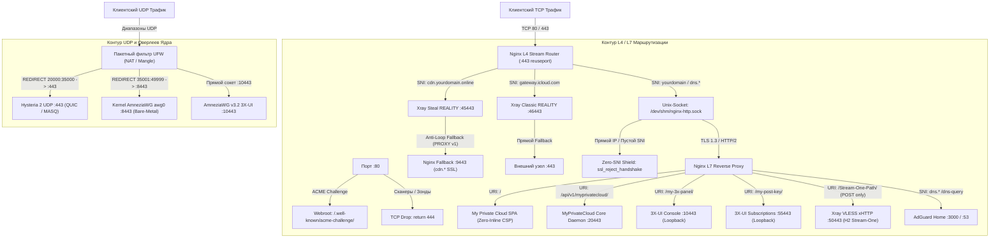

# 🛡️ Hardened Master Engine v3.7 MyPrivateCloud Ultra

Промышленная архитектура узла сетевой маскировки, квантово-устойчивого туннелирования и оверлейной маршрутизации: OS Hardening, TCP BBR, Nginx L4 Stream Router, 3X-UI, Xray Core v26.7.28 (Pinned), VLESS xHTTP (Native H2 Stream-One / ML-KEM-768 / Vision), VLESS REALITY (Steal-Oneself & Classic External), Hysteria 2 (Port Hopping), AdGuard Home DoH, нативный сервер AmneziaWG в ядре Linux (DKMS Bare-Metal, профиль AWG3, поддержка ядер 7.0+), пакетный фильтр UFW с MSS Clamping, изолированный веб-шлюз My Private Cloud SSO Hub и клиентская интеграция с роутерами OpenWrt (Podkop) / KeeneticOS.

---

## 📑 Содержание

1. [Сетевая архитектура и топология](#1-сетевая-архитектура-и-топология)
2. [Матрица сетевых сокетов и портов](#2-матрица-сетевых-сокетов-и-портов)
3. [Режимы развёртывания и архитектура миграции (Safe Migration)](#3-режимы-развёртывания-и-архитектура-миграции-safe-migration)
4. [Протоколы туннелирования и маскировки](#4-протоколы-туннелирования-и-маскировки)
5. [Маршрутизация, NAT и безопасность (UFW & WAN Engine)](#5-маршрутизация-nat-и-безопасность-ufw--wan-engine)
6. [Веб-маскировка и административный шлюз (My Private Cloud SSO Hub)](#6-веб-маскировка-и-административный-шлюз-my-private-cloud-sso-hub)
7. [Системные требования и установка](#7-системные-требования-и-установка)
8. [Параметры мастера установки](#8-параметры-мастера-установки)
9. [Клиентские конфигурации, подписки и интеграция с роутерами (OpenWrt / Keenetic)](#9-клиентские-конфигурации-подписки-и-интеграция-с-роутерами-openwrt--keenetic)
10. [Приватный DoH AdGuard Home](#10-приватный-doh-adguard-home)
11. [Эталонные образцы конфигураций инбаундов (Xray Core & AmneziaWG)](#11-эталонные-образцы-конфигураций-инбаундов-xray-core--amneziawg)
12. [Диагностика, мониторинг и сервисные команды](#12-диагностика-мониторинг-и-сервисные-команды)
13. [Резервное копирование и восстановление](#13-резервное-копирование-и-восстановление)
14. [Лицензия](#14-лицензия)

---

## 1. Сетевая архитектура и топология

Входящий сетевой трафик детерминированно разделяется на два аппаратно и логически изолированных контура:

1. **TCP-контур (Порты 80 и 443):**
   * **Порт 80:** Обрабатывает строго верификацию доменных имен Certbot ACME HTTP-01 (`^~ /.well-known/acme-challenge/`). Любые посторонние GET/POST-запросы, обращения ботов и сетевых сканеров немедленно сбрасываются на уровне ядра веб-сервера соединением `return 444` без отдачи HTTP-заголовков.
   * **Порт 443 (Nginx L4 Stream Router):** Модуль `ngx_stream_core_module` производит инспекцию входящего потока без терминации TLS на основе механизма `ssl_preread`:
     * Запросы к главному домену (`yourdomain.online`) и DNS (`dns.yourdomain.online`) передаются в локальный Unix-сокет оперативной памяти `/dev/shm/nginx-http.sock`;
     * Запросы к собственному поддомену маскировки (`cdn.yourdomain.online`) направляются на локальный инбаунд Xray Steal REALITY (`127.0.0.1:45443`);
     * Запросы с внешним SNI (`gateway.icloud.com` или `tbank.ru`) коммутируются на локальный инбаунд Xray Classic REALITY (`127.0.0.1:46443`);
     * Прямые сканирования по IP-адресу или обращения с некорректным SNI мгновенно отсекаются директивой `ssl_reject_handshake on` (Zero-SNI Shield).
   * **Anti-Loop Fallback (Порт 9443):**
     * Инбаунд Steal REALITY пересылает невалидный и probing-трафик через PROXY protocol v1 (`xver: 1`) на внутренний виртуальный хост Nginx (`127.0.0.1:9443`). Сервер отдает валидный SSL-сертификат поддомена `cdn.*`, ликвидируя риск детекта ТСПУ по таймаутам хэндшейка.

2. **UDP-контур (Скоростные пулы и оверлеи ядра):**
   * **Hysteria 2 (QUIC):** Базовый порт `:443/udp`. Скоростной пул динамического хоппинга `20000:35000/udp` аппаратно перенаправляется пакетным фильтром UFW на базовый порт.
   * **Native Kernel AmneziaWG (awg0):** Нативный модуль ядра Linux DKMS на сокете `:8443/udp`. Пул портов `35001:49999/udp` перенаправляется на сокет `8443/udp`, гарантируя непрерывность сессии при блокировке единичных портов.
   * **3X-UI UDP Stack:** Изолированный инбаунд AmneziaWG v3.2 на порту `:10443/udp` (подсеть `10.8.1.0/24`).



---

## 2. Матрица сетевых сокетов и портов

| Протокол / Демон | Сокет / Интерфейс | Область изоляции | Назначение и транспортные параметры |
| :--- | :--- | :--- | :--- |
| **ACME HTTP-01** | `80/tcp` | Публичная | Автоматический выпуск Let's Encrypt (любой иной трафик -> 444) |
| **Nginx L4 Ingress** | `443/tcp` | Публичная | Единая точка входа TCP, роутинг SNI без преждевременной терминации TLS |
| **Nginx Anti-Loop Fallback** | `127.0.0.1:9443` | Loopback | Безопасная терминация fallback-трафика Steal REALITY с PROXY protocol v1 |
| **MyPrivateCloud Core** | `127.0.0.1:20443`| Loopback | Python In-Memory SSO Hub, диспетчер аутентификации и API `awg0` |
| **3X-UI Web Panel** | `127.0.0.1:10443`| Loopback | Панель администрирования 3X-UI (доступ строго через SSO/Nginx) |
| **3X-UI Subscriptions**| `127.0.0.1:55443`| Loopback | Высокопроизводительный эндпоинт отдачи подписок клиентов |
| **VLESS xHTTP Stream-One**| `127.0.0.1:50443`| Loopback | Внутренний транспорт HTTP/2, ML-KEM-768, `flow: xtls-rprx-vision` |
| **VLESS Steal REALITY** | `127.0.0.1:45443`| Loopback | Прием трафика Steal-Oneself поддомена `cdn.*` |
| **VLESS Classic REALITY**| `127.0.0.1:46443`| Loopback | Прием трафика Classic REALITY с маскировкой под `gateway.icloud.com` |
| **AdGuard Home Web** | `127.0.0.1:3000` | Loopback | Административный веб-интерфейс AdGuard Home |
| **AdGuard Home DNS** | `127.0.0.1:53` / `10.9.0.1:53` | Локальная / Оверлей | Рекурсивный DoH-резолвер для системы и туннеля `awg0` |
| **Hysteria 2 Server** | `443/udp` | Публичная | Высокоскоростной транспорт QUIC (TLS 1.3, ALPN `h3`) |
| **Hy2 Hopping Range** | `20000:35000/udp`| Публичная | Пул динамической ротации портов Hysteria 2 |
| **Kernel AmneziaWG** | `8443/udp` (awg0) | Публичная | Нативный сервер ядра Linux (DKMS Bare-Metal, MTU 1360 / MSS 1320) |
| **AWG Native Speed Pool**| `35001:49999/udp`| Публичная | Скоростной мультипортовый диапазон (Redirect -> `:8443/udp`) |
| **3X-UI AmneziaWG v3.2** | `10443/udp` | Публичная | Выделенный UDP-инбаунд AWG v3.2 внутри 3X-UI (подсеть `10.8.1.0/24`) |

---

## 3. Режимы развёртывания и архитектура миграции (Safe Migration)

Инсталлятор поддерживает детерминированное разделение на два сценария установки:

### Сценарий 1: Чистая установка (Clean Setup — `INSTALL_MODE="1"`)
Полная инициализация операционной системы, создание заново всех криптографических ключей (REALITY, ML-KEM-768, WireGuard/AmneziaWG), генерация первичного пользователя панели, эталонных инбаундов и создание тестового клиента `Test` с единой связкой UUID и `subId`.

### Сценарий 2: Безопасное обновление (Safe Migration Mode — `INSTALL_MODE="2"`)
Режим автоматически активируется при обнаружении существующей базы данных `/etc/x-ui/x-ui.db`. 
1. **Сохранение идентичности клиентов:**
   * UUID, хэши паролей, статистика трафика, сроки действия учетных записей, индивидуальные токены подписок `subId` и клиентские связки в таблицах `client_inbounds` и `client_traffics` **сохраняются на 100%**.
   * Существующие клиенты не привязываются принудительно к новым инбаундам во избежание засорения конфигураций.
2. **Защита пользовательских наименований (`remark`):**
   * Названия действующих инбаундов и хостов не сбрасываются в значения по умолчанию.
3. **Безусловная нормализация схемы под Zod / 3X-UI v2.4+:**
   * Поле `settings.encryption` в инбаундах VLESS принудительно устанавливается в `"none"` вместо пустого значения `""` (предотвращение ошибки валидатора `String must contain at least 1 character(s)`).
   * Поля `alpn` и `pinnedPeerCertSha256` внутри секции `externalProxy` приводятся строго к типу массивов JSON (`array`), исключая падение фронтенда панели при сериализации.
4. **Интеллектуальная адаптация xHTTP:**
   * URI-путь и локальный порт xHTTP считываются напрямую из существующей базы данных SQLite, исключая десинхронизацию с работающими клиентами.
5. **Атомарные чекпоинты WAL:**
   * До создания резервного архива и после модификаций выполняются команды `PRAGMA wal_checkpoint(FULL)` и `PRAGMA wal_checkpoint(TRUNCATE)`, предотвращающие повреждение SQLite-транзакций.

---

## 4. Протоколы туннелирования и маскировки

### 1. VLESS xHTTP (Native H2 Stream-One + ML-KEM-768 + Vision) — ЭТАЛОН
* **Архитектура транспорта:** В отличие от устаревших реализаций, Nginx принимает xHTTP строго по протоколу HTTP/2 (`http2 on;`), верифицирует HTTP-метод (`POST` — разрешен, остальные методы сбрасываются кодом `404`), полностью отключает буферизацию запросов и ответов (`proxy_request_buffering off; proxy_buffering off;`) и проксирует поток на сокет Xray через `proxy_http_version 2;`.
* **Постквантовое шифрование ML-KEM-768:** Генерация ключевой пары производится встроенным вызовом `$XRAY_BIN vlessenc` по стандарту FIPS 203 / Kyber Round 3. Сервер принимает ключ `decryption`, клиенту выдается `encryption`.
* **Flow:** Задействован протокол обфускации длин потоков `xtls-rprx-vision`.
* **Обфускация паддинга:** Режим `stream-one` с псевдослучайным паддингом пакетов длиной `120-1120` байт, упакованным в пользовательский HTTP-заголовок `X-Amz-Meta-Trace`. Активно сессионное мультиплексирование `xmux` (сессии до 3000 секунд, `maxConnections: 1-3`).

### 2. VLESS Steal-Oneself REALITY (`:45443`)
* Маскировка под собственный поддомен `cdn.yourdomain.online`. Не-VPN трафик перенаправляется на локальный fallback-сервер `127.0.0.1:9443` через протокол PROXY v1 (`xver: 1`), устраняя сигнатурный признак обрыва соединения при активном зондировании ТСПУ.

### 3. VLESS Classic REALITY (`:46443`)
* Маскировка под доверенные внешние CDN/сервисы (по умолчанию `gateway.icloud.com` или `tbank.ru` при выборе сетевого профиля РФ). Инсталлятор автоматически выполняет бенчмарк задержки RTT и выбирает наиболее доступный SNI.

### 4. Hysteria 2 (UDP `:443` + Hopping)
* Высокоскоростной транспорт на базе протокола QUIC. Поддержка маскировки трафика через обратный HTTP-прокси (`http://127.0.0.1:80`), устойчивость к высокому уровню потерь пакетов (до 30–40%) благодаря алгоритму управления перегрузками Brutal Congestion Control.

### 5. Нативный сервер AmneziaWG в ядре Linux (`awg0`, Bare-Metal DKMS)
* **Поддержка ядер Linux 7.0+:** Скрипт включает функцию `patch_amnezia_dkms_kernel_compat`, выполняющую бэкпортирование заголовочных файлов модуля при работе на современных версиях ядер (7.0+).
* **Спецификация Golden Matrix (AWG3):**
  * Математическая изоляция сигнатур длин рукопожатий:
    $$S1 + 56 \neq S2 \quad (72 + 56 = 128 \neq 56) \quad \text{— разделение Init (148B) и Response (92B)}$$
    $$S3 \neq S2 + 28 \quad (32 \neq 56 + 28 = 84) \quad \text{— разделение Response (92B) и Cookie (64B)}$$
    $$S1, S2, S3, S4 \ge 12 \quad \text{— защита энтропии ChaCha20 Nonce}$$
  * Фиксированные параметры: `MTU = 1360`, `TCPMSS = 1320`, `Jc = 4`, `Jmin = 40`, `Jmax = 70`, `S1 = 72`, `S2 = 56`, `S3 = 32`, `S4 = 16`.
  * Диапазоны $H1..H4$: Псевдослучайные скаляры ($10^7 - 2147483647$) для аппаратной совместимости со встроенными клиентами маршрутизаторов.

---

## 5. Маршрутизация, NAT и безопасность (UFW & WAN Engine)

### Универсальный сетевой детектор WAN (Universal WAN Engine Tier 1–4)
Определение внешнего интерфейса узла выполняется по многоуровневому алгоритму:
1. **Tier 1:** Опрос FIB ядра Linux через Anycast-маршруты `ip route get` к канареечным адресам (`1.1.1.1`, `8.8.8.8`, `77.88.8.8`, `9.9.9.9`);
2. **Tier 2:** Извлечение шлюза по умолчанию из основной таблицы маршрутизации ядра;
3. **Tier 3:** Сканирование виртуальной ФС `/sys/class/net/*` с исключением виртуальных интерфейсов (`docker*`, `veth*`, `wg*`, `awg*`, `tailscale*` и др.) и проверкой физического линка (`operstate=up` / `carrier=1`);
4. **Tier 4:** Аварийный fallback на интерфейс `eth0`.

### Сетевой экран и трансляция адресов (UFW `/etc/ufw/before.rules`)
* **PREROUTING REDIRECT:**
  * Порты Hysteria 2: `20000:35000/udp` $\to$ `:443/udp`;
  * Порты AmneziaWG: `35001:49999/udp` $\to$ `:8443/udp`.
* **POSTROUTING MASQUERADE:**
  * Оверлей `10.9.0.0/24` (`awg0`) $\to$ маскарадинг в WAN-интерфейс;
  * Подсеть `10.8.1.0/24` (3X-UI AWG v3.2) $\to$ маскарадинг в WAN-интерфейс.
* **TCP MSS Clamping (Таблица `*mangle`):**
  * Принудительная фиксация MSS на уровне `1320` для подсетей `10.9.0.0/24` и `10.8.1.0/24`, ликвидирующая Path MTU Discovery Blackhole при инкапсуляции.
* **Аппаратная изоляция сокетов:**
  * Внутренние служебные порты (`10443`, `55443`, `50443`, `45443`, `46443`, `9443`, `3000`, `20443`) закрыты на внешнем интерфейсе директивами `ufw deny`.

---

## 6. Веб-маскировка и административный шлюз (My Private Cloud SSO Hub)

* **Фронтенд-маскировка (Decoy Shield v3.14):**
  * Развернута в `/var/www/html`.
  * Соответствие спецификации **OWASP Zero-Leak**: строжайшая политика CSP (`default-src 'self'`), полный отказ от внешних CDN, сторонних шрифтов и счетчиков телеметрии. Иконки внедрены через нативный SVG.
* **In-Memory SSO Hub:**
  * Доступ к управлению узлом осуществляется по нажатию кнопки **«Авторизация»**.
  * Форма авторизации отправляет учетные данные в демон `myprivatecloud-core.py` (`127.0.0.1:20443`). Сверка хэшей паролей выполняется в защищенном режиме с защитой от атак по времени (`hmac.compare_digest` / `bcrypt`).
  * При успешной аутентификации разметка панели управления динамически генерируется в DOM-дереве браузера:
    1. Бесшовный переход в консоль 3X-UI;
    2. Полнофункциональный менеджер пиров `awg0` ядра Linux (добавление клиентов, мгновенная генерация QR-кода, скачивание `.conf`, отзыв ключей);
    3. Прямой переход в интерфейс AdGuard Home.

---

## 7. Системные требования и установка

### Поддерживаемые операционные системы:
* **Ubuntu:** 22.04 LTS (Jammy), 24.04 LTS (Noble), 26.04 LTS
* **Debian:** 12 (Bookworm), 13 (Trixie)

### Предварительные условия:
1. Права суперпользователя `root` на сервере (KVM или Bare-Metal).
2. Наличие зарегистрированного доменного имени. DNS A-записи домена и поддоменов (`yourdomain.online`, `cdn.yourdomain.online`, `dns.yourdomain.online`) должны указывать на публичный IPv4-адрес сервера.
3. В панели DNS Cloudflare проксирование должно быть **ОТКЛЮЧЕНО** (режим *DNS Only* / «серое облако»).

### Команда запуска автоустановщика:
```bash
bash <(curl -fsSL https://raw.githubusercontent.com/Itman75/Nginx-L4-Stream-Router-Mask-for-3x-ui/main/install.sh)
```

---

## 8. Параметры мастера установки

| Параметр мастера | Дефолтное значение | Техническое описание |
| :--- | :--- | :--- |
| **Режим установки** | `2` (при наличии БД) | `1` — Clean Install (сброс базы); `2` — Safe Migration (сохранение клиентов и UUID). |
| **Сетевой профиль** | Автодетект (RU / World) | RU: Яндекс DNS (`77.88.8.8`), зеркала CDN; World: Cloudflare DNS (`1.1.1.1`). |
| **Главный FQDN домен** | — | Домен L7 терминации Nginx, xHTTP и веб-маскировки (`yourdomain.online`). |
| **Email Let's Encrypt** | Опционально | Регистрация аккаунта Certbot для получения SSL-сертификатов. |
| **Порт SSH** | Текущий активный | Перенос порта демона `sshd`, настройка Fail2ban и генерация Ed25519 ключей. |
| **Локальные пути 3X-UI**| Из базы / `/my-3x-panel/` | Секретный URI-путь веб-консоли и внутренний сокет (`:10443`). |
| **Порт подписок 3X-UI** | Из базы / `/my-post-key/` | Секретный URI-путь сервера подписок и внутренний сокет (`:55443`). |
| **VLESS xHTTP Inbound** | `:50443`, `/Stream-One-Path/` | Внутренний сокет и URI потока Native H2 Stream-One с ML-KEM-768. |
| **Steal REALITY** | `:45443` | Поддомен `cdn.yourdomain.online`, fallback на Nginx `:9443` (PROXY v1). |
| **Classic REALITY** | `:46443` | Внешний доверенный SNI (`gateway.icloud.com` или `tbank.ru`). |
| **Hysteria 2 UDP** | `:443/udp` | Активация скоростного пула Port Hopping `20000:35000/udp`. |
| **Kernel AmneziaWG** | `:8443/udp` | Активация нативного интерфейса ядра `awg0` и пула `35001:49999/udp`. |
| **AmneziaWG v3.2 (3X)**| `:10443/udp` | Выделенный UDP-порт для инбаунда AWG v3.2 в 3X-UI. |
| **AdGuard Home DoH** | `dns.yourdomain.online` | Развёртывание DoH-шлюза с привязкой ClientID для роутеров. |
| **SSL-движок** | Certbot HTTP-01 | Нативный выпуск Let's Encrypt через вебрут `/var/www/html`. |

---

## 9. Приватный DoH AdGuard Home

Служба изолирована на `127.0.0.1:3000` и обслуживается через прокси Nginx с проверкой `ClientID`. Порт 53 закрыт извне.

* **Панель управления DNS:** `https://dns.yourdomain.online/`
* **DoH URL для клиентов:** `https://dns.yourdomain.online/dns-query/home-router`

### Настройка роутера OpenWrt (Пакет Podkop / Https-DNS-Proxy):
1. **Службы** $\to$ **Podkop** $\to$ **Настройки** (вкладка DNS):
   * Протокол: `DNS через HTTPS (DoH)`;
   * Строка подключения (URL без https://): `dns.yourdomain.online/dns-query/home-router`;
   * Bootstrap DNS: `77.88.8.8` (для РФ) или `1.1.1.1` (для Зарубежья).
2. Сохранить настройки и перезапустить службу Podkop для маршрутизации DNS-запросов через AdGuard Home.

### Настройка роутера Keenetic (KeeneticOS):
1. **Сетевые правила** $\to$ **Интернет-фильтр** (вкладка «Серверы DNS»).
2. Добавить DNS-сервер:
   * Адрес DNS (Bootstrap): `77.88.8.8` или `1.1.1.1` *(не указывать IP своего VPS)*;
   * Протокол: `DNS-over-HTTPS (DoH)`;
   * URL-адрес: `https://dns.yourdomain.online/dns-query/home-router`;
   * SNI: `dns.yourdomain.online`.
3. Включить опцию «Игнорировать DNS провайдера».

---

## 10. Клиентские конфигурации, подписки и интеграция с роутерами (OpenWrt / Keenetic)

Все сгенерированные доступы и ключи сохраняются в защищенном файле `/root/vpn_credentials.txt` (`chmod 600`).

### Ссылки единой клиентской подписки (мультипротокольные):
* **Универсальная подписка (Base64 / v2ray / v2rayN):**  
  `https://yourdomain.online/my-post-key/SUB_Test`
* **Подписка JSON Outbounds (Sing-box v1.10+ / v1.11+):**  
  `https://yourdomain.online/my-post-key/sub-json/SUB_Test`
* **Подписка Clash / Mihomo Meta (YAML):**  
  `https://yourdomain.online/my-post-key/sub-clash/SUB_Test`

### Интеграция с роутерами OpenWrt (Пакет Podkop)
Пакет **Podkop** на базе OpenWrt обеспечивает выборочный обход блокировок и нативную работу со сформированным узлом:

1. **Импорт конфигурации туннеля (Sing-box / Xray / AWG):**
   * **Службы** $\to$ **Podkop** $\to$ **Поставщики прокси** (Proxy Providers).
   * Добавить новый источник:
     * Тип: `Sing-box JSON` (рекомендуется) или `VLESS / WireGuard`;
     * URL подписки: `https://yourdomain.online/my-post-key/sub-json/SUB_Test`;
     * Период обновления: `12ч` (или по расписанию).
   * *Для прямого использования AmneziaWG:* Установить пакет `kmod-amneziawg` / `amneziawg-tools` и импортировать файл `/root/amneziawg-client.conf` как нативный интерфейс в LuCI Network $\to$ Interfaces.
2. **Параметры маршрутизации и обхода:**
   * В настройках Podkop выбрать созданный провайдер прокси для списков обхода (Гео-IP / доменные списки).

### Логика назначения параметра `DNS`:
1. `DNS = 10.9.0.1` — при включённом AdGuard Home (запросы идут в туннель на локальный фильтрующий резолвер).
2. `DNS = 1.1.1.1, 8.8.8.8` — профиль EU/World.
3. `DNS = 77.88.8.8, 77.88.8.1` — профиль RU (Яндекс.DNS).

---

## 11. Эталонные образцы конфигураций инбаундов (Xray Core & AmneziaWG)

Ниже приведены полностью анонимизированные, синтаксически валидированные конфигурационные шаблоны основных подсистем узла, готовые к практическому применению.

### 1. VLESS Steal-Oneself REALITY Inbound (JSON)
```json
{
  "listen": "127.0.0.1",
  "port": 45443,
  "protocol": "vless",
  "tag": "in-45443-tcp",
  "settings": {
    "decryption": "none",
    "encryption": "none",
    "testseed": [
      900,
      500,
      900,
      256
    ]
  },
  "sniffing": {
    "enabled": true,
    "destOverride": [
      "http",
      "tls",
      "quic",
      "fakedns"
    ]
  },
  "streamSettings": {
    "network": "tcp",
    "security": "reality",
    "tcpSettings": {
      "acceptProxyProtocol": true,
      "header": {
        "type": "none"
      }
    },
    "realitySettings": {
      "show": false,
      "xver": 1,
      "target": "127.0.0.1:9443",
      "dest": "127.0.0.1:9443",
      "serverNames": [
        "cdn.yourdomain.online"
      ],
      "privateKey": "ANONYMIZED_REALITY_PRIVATE_KEY_32BYTES_BASE64=",
      "minClientVer": "1.0.0",
      "maxClientVer": "",
      "maxTimediff": 0,
      "shortIds": [
        "0123456789abcdef"
      ],
      "mldsa65Seed": "",
      "settings": {
        "publicKey": "ANONYMIZED_REALITY_PUBLIC_KEY_32BYTES_BASE64=",
        "fingerprint": "firefox",
        "serverName": "cdn.yourdomain.online",
        "spiderX": "/",
        "mldsa65Verify": ""
      },
      "spiderX": "/"
    },
    "externalProxy": [
      {
        "dest": "yourdomain.online",
        "port": 443,
        "forceTls": "same",
        "sni": "cdn.yourdomain.online",
        "remark": "REALITY Steal-OneSelf (cdn.yourdomain.online)"
      }
    ]
  }
}
```

### 2. VLESS Classic REALITY Inbound (JSON)
```json
{
  "listen": "127.0.0.1",
  "port": 46443,
  "protocol": "vless",
  "tag": "in-46443-tcp",
  "settings": {
    "decryption": "none",
    "encryption": "none",
    "testseed": [
      900,
      500,
      900,
      256
    ]
  },
  "sniffing": {
    "enabled": true,
    "destOverride": [
      "http",
      "tls",
      "quic",
      "fakedns"
    ]
  },
  "streamSettings": {
    "network": "tcp",
    "security": "reality",
    "tcpSettings": {
      "acceptProxyProtocol": true,
      "header": {
        "type": "none"
      }
    },
    "realitySettings": {
      "show": false,
      "xver": 0,
      "target": "gateway.icloud.com:443",
      "dest": "gateway.icloud.com:443",
      "serverNames": [
        "gateway.icloud.com"
      ],
      "privateKey": "ANONYMIZED_REALITY_PRIVATE_KEY_32BYTES_BASE64=",
      "minClientVer": "1.0.0",
      "maxClientVer": "",
      "maxTimediff": 0,
      "shortIds": [
        "0123456789abcdef"
      ],
      "mldsa65Seed": "",
      "settings": {
        "publicKey": "ANONYMIZED_REALITY_PUBLIC_KEY_32BYTES_BASE64=",
        "fingerprint": "firefox",
        "serverName": "gateway.icloud.com",
        "shortId": "0123456789abcdef",
        "spiderX": "/",
        "mldsa65Verify": ""
      },
      "spiderX": "/"
    },
    "externalProxy": [
      {
        "dest": "yourdomain.online",
        "port": 443,
        "forceTls": "same",
        "sni": "gateway.icloud.com",
        "remark": "REALITY Classic (gateway.icloud.com)"
      }
    ]
  }
}
```

### 3. VLESS xHTTP (Native H2 Stream-One + Post-Quantum ML-KEM-768) (JSON)
```json
{
  "listen": "127.0.0.1",
  "port": 50443,
  "protocol": "vless",
  "tag": "in-50443-tcp",
  "settings": {
    "decryption": "mlkem768x25519plus.native.600s.ANONYMIZED_POST_QUANTUM_SERVER_DECRYPTION_KEY",
    "encryption": "mlkem768x25519plus.native."
  },
  "sniffing": {
    "enabled": true,
    "destOverride": [
      "http",
      "tls",
      "quic",
      "fakedns"
    ]
  },
  "streamSettings": {
    "network": "xhttp",
    "xhttpSettings": {
      "path": "/Stream-One-Path/",
      "host": "yourdomain.online",
      "mode": "stream-one",
      "xPaddingBytes": "120-1120",
      "xPaddingObfsMode": true,
      "xPaddingKey": "X-Amz-Meta-Trace",
      "xPaddingHeader": "",
      "xPaddingPlacement": "",
      "xPaddingMethod": "",
      "sessionIDPlacement": "",
      "sessionIDKey": "",
      "sessionIDTable": "",
      "sessionIDLength": "",
      "seqPlacement": "",
      "seqKey": "",
      "uplinkDataPlacement": "",
      "uplinkDataKey": "",
      "scMaxEachPostBytes": "",
      "noSSEHeader": true,
      "scMaxBufferedPosts": 30,
      "scStreamUpServerSecs": "20-80",
      "serverMaxHeaderBytes": 0,
      "uplinkHTTPMethod": "",
      "headers": {},
      "scMinPostsIntervalMs": "",
      "uplinkChunkSize": 0,
      "noGRPCHeader": false,
      "xmux": {
        "maxConcurrency": "0",
        "maxConnections": "1-3",
        "cMaxReuseTimes": "300-600",
        "hMaxRequestTimes": "600-900",
        "hMaxReusableSecs": "1800-3000",
        "hKeepAlivePeriod": 600
      },
      "enableXmux": true
    },
    "security": "none",
    "externalProxy": [
      {
        "dest": "yourdomain.online",
        "port": 443,
        "forceTls": "tls",
        "sni": "yourdomain.online",
        "fingerprint": "firefox",
        "alpn": [
          "h2"
        ],
        "remark": "VLESS xHTTP (yourdomain.online)"
      }
    ]
  }
}
```

### 4. Hysteria 2 Inbound (QUIC) (JSON)
```json
{
  "listen": "0.0.0.0",
  "port": 443,
  "protocol": "hysteria",
  "tag": "in-443-udp",
  "settings": {
    "version": 2
  },
  "sniffing": {
    "enabled": true,
    "destOverride": [
      "http",
      "tls",
      "quic",
      "fakedns"
    ]
  },
  "streamSettings": {
    "network": "hysteria",
    "hysteriaSettings": {
      "version": 2,
      "udpIdleTimeout": 60,
      "masquerade": {
        "type": "proxy",
        "url": "http://127.0.0.1:80"
      }
    },
    "security": "tls",
    "tlsSettings": {
      "serverName": "yourdomain.online",
      "minVersion": "1.3",
      "maxVersion": "1.3",
      "certificates": [
        {
          "certificateFile": "/etc/letsencrypt/live/yourdomain.online/fullchain.pem",
          "keyFile": "/etc/letsencrypt/live/yourdomain.online/privkey.pem",
          "useFile": true
        }
      ],
      "alpn": [
        "h3"
      ],
      "settings": {}
    },
    "externalProxy": [
      {
        "dest": "yourdomain.online",
        "port": 443,
        "forceTls": "tls",
        "alpn": [
          "h3"
        ],
        "remark": "Hysteria 2 (yourdomain.online)"
      }
    ]
  }
}
```

### 5. Клиентская конфигурация AmneziaWG (awg0 / INI)
```ini
[Interface]
Address = 10.9.0.2/32
PrivateKey = ANONYMIZED_CLIENT_PRIVATE_KEY_BASE64=
DNS = 10.9.0.1
MTU = 1360
Jc = 4
Jmin = 40
Jmax = 70
S1 = 72
S2 = 56
S3 = 32
S4 = 16
H1 = 387638859
H2 = 1474900093
H3 = 838332052
H4 = 1748117435

[Peer]
PublicKey = ANONYMIZED_SERVER_PUBLIC_KEY_BASE64=
Endpoint = yourdomain.online:8443
AllowedIPs = 0.0.0.0/0
PersistentKeepalive = 25
```

---

## 12. Диагностика, мониторинг и сервисные команды

```bash
# 1. Проверка синтаксиса и перезапуск внешнего шлюза Nginx
nginx -t && systemctl restart nginx
systemctl status nginx --no-pager

# 2. Проверка состояния локального Unix-сокета в RAM
ls -la /dev/shm/nginx-http.sock

# 3. Верификация защиты Zero-SNI (соединение обязано сбрасываться при вызове по IP)
curl -Iv https://IP_АДРЕС_СЕРВЕРА 2>&1 | grep -E 'SSL|handshake|alert|Connection reset'

# 4. Проверка поддержки HTTP/2 на главном домене L7
curl -I --http2 -s https://yourdomain.online/ | grep -i "HTTP/"

# 5. Верификация изоляции VLESS xHTTP (GET-запрос обязан отдавать 404 Not Found)
curl -Iv --http2 https://yourdomain.online/Stream-One-Path/

# 6. Мониторинг оверлейного интерфейса awg0 ядра Linux и активных сессий пиров
awg show awg0
ip -s link show awg0

# 7. Проверка статуса сервиса MyPrivateCloud Core SSO Gateway
systemctl status myprivatecloud-core --no-pager
ss -tlnp | grep 20443

# 8. Проверка сетевых слушателей TCP и UDP
ss -tlnp | grep -E '10443|55443|50443|45443|46443|9443|3000|20443'
ss -ulnp | grep -E '443|8443|10443'

# 9. Проверка правил пакетного фильтра UFW (NAT, Redirect, TCPMSS)
ufw status verbose
grep -E 'PREROUTING|POSTROUTING|TCPMSS' /etc/ufw/before.rules

# 10. Проверка логов ядра Xray Core
journalctl -u x-ui --no-pager -n 50
```

---

## 13. Резервное копирование и восстановление

### Создание атомарного горячего архива системы:
```bash
python3 -c "import sqlite3; c=sqlite3.connect('/etc/x-ui/x-ui.db'); c.execute('PRAGMA wal_checkpoint(FULL);'); c.close()" 2>/dev/null || true

tar -czvf /root/backup_myprivatecloud_$(date +%F_%H%M%S).tar.gz \
  /etc/x-ui \
  /etc/nginx \
  /etc/letsencrypt \
  /etc/ssl/acme \
  /etc/amnezia/amneziawg \
  /opt/AdGuardHome/AdGuardHome.yaml \
  /var/www/html \
  /etc/ufw/before.rules \
  /root/amneziawg-client.conf 2>/dev/null || true
chmod 600 /root/backup_myprivatecloud_*.tar.gz
```

### Восстановление узла из резервной копии:
```bash
systemctl stop x-ui nginx AdGuardHome myprivatecloud-core awg-quick@awg0 2>/dev/null || true
rm -f /etc/x-ui/x-ui.db-wal /etc/x-ui/x-ui.db-shm
tar -xzvf /root/backup_myprivatecloud_ИМЯ_АРХИВА.tar.gz -C /
nginx -t && systemctl start nginx x-ui AdGuardHome myprivatecloud-core awg-quick@awg0
```

---

## 14. Лицензия

Программный комплекс распространяется под условиями открытой лицензии **MIT**. Полный текст лицензии доступен в файле [LICENSE](LICENSE).
