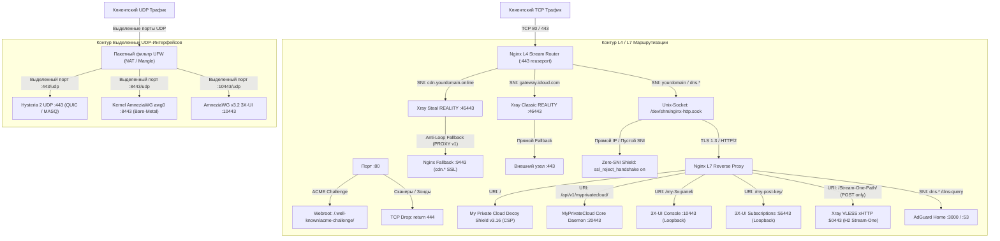

# 🛡️ Hardened Master Engine v3.8 MyPrivateCloud Ultra

[](#)
[](#)
[-success.svg)](#)
[](#)
[-red.svg)](#)
[](#)

Комплексный программный стек развёртывания узла сетевой маскировки, устойчивого туннелирования и оверлейной маршрутизации: OS Hardening, TCP BBR, Nginx L4 Stream Router, 3X-UI, Xray Core v26.7.28 (Pinned), VLESS xHTTP (Native H2 Stream-One / ML-KEM-768 / Vision), VLESS REALITY (Steal-Oneself & Classic External), Hysteria 2 (QUIC), AdGuard Home DoH, нативный сервер AmneziaWG в ядре Linux (DKMS Bare-Metal awg0, поддержка ядер 7.0+), пакетный фильтр UFW с MSS Clamping, изолированный веб-шлюз My Private Cloud SSO Hub и клиентская интеграция с роутерами OpenWrt (Podkop) / KeeneticOS.

---

## 📑 Содержание

1. [Сетевая архитектура и топология](#1-сетевая-архитектура-и-топология)
2. [Матрица сетевых сокетов и портов](#2-матрица-сетевых-сокетов-и-портов)
3. [Режимы развёртывания и архитектура миграции (Safe Migration v3.8)](#3-режимы-развёртывания-и-архитектура-миграции-safe-migration-v38)
4. [Протоколы туннелирования и маскировки](#4-протоколы-туннелирования-и-маскировки)
5. [Маршрутизация, NAT и безопасность (UFW & WAN Engine)](#5-маршрутизация-nat-и-безопасность-ufw--wan-engine)
6. [Веб-маскировка и административный шлюз (My Private Cloud SSO Hub)](#6-веб-маскировка-и-административный-шлюз-my-private-cloud-sso-hub)
7. [Системные требования и аппаратные профили (Hardware Tiering)](#7-системные-требования-и-аппаратные-профили-hardware-tiering)
8. [Установка и параметры мастера](#8-установка-и-параметры-мастера)
9. [Приватный DoH AdGuard Home](#9-приватный-doh-adguard-home)
10. [Клиентские конфигурации, подписки и интеграция с роутерами (OpenWrt / Keenetic)](#10-клиентские-конфигурации-подписки-и-интеграция-с-роутерами-openwrt--keenetic)
11. [Эталонные образцы конфигураций инбаундов (Xray Core & AmneziaWG)](#11-эталонные-образцы-конфигураций-инбаундов-xray-core--amneziawg)
12. [Автоматическое обслуживание и предохранитель ядра (Circuit Breaker)](#12-автоматическое-обслуживание-и-предохранитель-ядра-circuit-breaker)
13. [Диагностика, мониторинг и сервисные команды](#13-диагностика-мониторинг-и-сервисные-команды)
14. [Резервное копирование и восстановление](#14-резервное-копирование-и-восстановление)
15. [Лицензия](#15-лицензия)

---

## 1. Сетевая архитектура и топология

Входящий сетевой трафик детерминированно разделяется на два аппаратно и логически изолированных контура:

1. **TCP-контур (Порты 80 и 443):**
   * **Порт 80/tcp:** Обрабатывает строго верификацию доменных имен Certbot ACME HTTP-01 (`^~ /.well-known/acme-challenge/`). Все прочие запросы сканеров и ботов сбрасываются соединением `return 444;` без передачи HTTP-заголовков.
   * **Порт 443/tcp (Nginx L4 Stream Router):** Модуль `ngx_stream_core_module` выполняет инспекцию потока без терминации TLS через механизм `ssl_preread`:
     * Главный домен (`PRIMARY_DOMAIN`) и DNS-поддомен (`AGH_DOMAIN`) коммутируются в Unix-сокет оперативной памяти `/dev/shm/nginx-http.sock`;
     * Поддомен маскировки Steal-REALITY (`cdn.yourdomain.online`) направляется на сокет Xray (`127.0.0.1:45443`);
     * Внешний доверенный SNI Classic REALITY (`gateway.icloud.com` / `tbank.ru`) передается на сокет Xray (`127.0.0.1:46443`);
     * Прямые сканирования по IP-адресу или некорректные SNI немедленно отсекаются директивой `ssl_reject_handshake on;` (**Zero-SNI Shield**).
   * **Anti-Loop Fallback (Порт 9443):**
     * Инбаунд Steal REALITY пересылает невалидный трафик через PROXY protocol v1 (`xver: 1`) на внутренний виртуальный хост Nginx (`127.0.0.1:9443`). Сервер отдает валидный SSL-сертификат поддомена, исключая детекцию активными зондами DPI по таймаутам хэндшейка.

2. **Выделенный UDP-контур (Dedicated UDP Architecture):**
   * **Hysteria 2 (QUIC):** Выделенный порт `:443/udp`. TLS 1.3, ALPN `["h3"]`, защита от перегрузок Brutal Congestion Control, маскировка под HTTP-прокси к `127.0.0.1:80`.
   * **Native Kernel AmneziaWG (awg0):** Нативный модуль ядра Linux DKMS на выделенном порту `:8443/udp` (MTU 1360 / MSS 1320).
   * **3X-UI Userspace AWG v3.2:** Изолированный UDP-инбаунд на порту `:10443/udp` (подсеть `10.8.1.0/24`).



---

## 2. Матрица сетевых сокетов и портов

| Протокол / Демон | Сокет / Интерфейс | Область изоляции | Назначение и транспортные параметры |
| :--- | :--- | :--- | :--- |
| **ACME HTTP-01** | `80/tcp` | Публичная | Выпуск сертификатов Let's Encrypt (все остальные запросы $\to$ `444 Drop`) |
| **Nginx L4 Ingress** | `443/tcp` | Публичная | Единая точка входа TCP, роутинг `ssl_preread` без терминации TLS |
| **Nginx Fallback** | `127.0.0.1:9443` | Loopback | Безопасная терминация fallback-трафика Steal REALITY с PROXY protocol v1 |
| **MyPrivateCloud Core** | `127.0.0.1:20443`| Loopback | FastAPI/Uvicorn SSO Hub, диспетчер аутентификации и пиров `awg0` |
| **3X-UI Web Panel** | `127.0.0.1:10443`| Loopback | Панель администрирования 3X-UI (доступ строго через Nginx / SSO) |
| **3X-UI Subscriptions**| `127.0.0.1:55443`| Loopback | Эндпоинт генерации и выдачи подписок клиентов |
| **VLESS xHTTP Stream-One**| `127.0.0.1:50443`| Loopback | Транспорт HTTP/2, ML-KEM-768, `flow: xtls-rprx-vision` |
| **VLESS Steal REALITY** | `127.0.0.1:45443`| Loopback | Прием трафика Steal-Oneself поддомена `cdn.*` |
| **VLESS Classic REALITY**| `127.0.0.1:46443`| Loopback | Прием трафика Classic REALITY с маскировкой под внешний SNI |
| **AdGuard Home Web** | `127.0.0.1:3000` | Loopback | Административный веб-интерфейс AdGuard Home (SSO Cookie Gate) |
| **AdGuard Home DNS** | `127.0.0.1:53` / `10.9.0.1:53` | Локальная / Оверлей | Рекурсивный DoH-резолвер для системы и оверлея `awg0` |
| **Hysteria 2 Server** | `443/udp` | Публичная | Выделенный QUIC-транспорт (TLS 1.3, ALPN `h3`, MASQ HTTP/80) |
| **Kernel AmneziaWG** | `8443/udp` (awg0) | Публичная | Нативный сервер ядра Linux (DKMS Bare-Metal, MTU 1360 / MSS 1320) |
| **3X-UI AmneziaWG v3.2** | `10443/udp` | Публичная | Выделенный UDP-инбаунд AWG v3.2 внутри 3X-UI (подсеть `10.8.1.0/24`) |

---

## 3. Режимы развёртывания и архитектура миграции (Safe Migration v3.8)

Инсталлятор поддерживает разделение на два независимых сценария:

### Сценарий 1: Чистая установка (Clean Setup — `INSTALL_MODE="1"`)
Полная инициализация ОС, генерация криптографических пар (REALITY, ML-KEM-768, WireGuard/AmneziaWG), создание первичного пользователя панели, эталонных инбаундов и развёртывание тестового клиента `Test` с единой связкой UUID и `subId`.

### Сценарий 2: Безопасное обновление (Safe Migration Mode — `INSTALL_MODE="2"`)
Режим активируется автоматически при обнаружении существующей базы данных `/etc/x-ui/x-ui.db`.
1. **Сохранение идентичности клиентов:**
   * UUID, хэши паролей, статистика трафика, сроки действия, токены `subId` и связи в таблицах `client_inbounds` и `client_traffics` **сохраняются без потерь**.
   * Клиенты не привязываются принудительно к новым инбаундам во избежание засорения клиентских профилей.
2. **Защита пользовательских наименований (`remark`):**
   * Названия действующих инбаундов и хостов не сбрасываются в значения по умолчанию.
3. **Строгая сериализация схемы GORM `hosts.alpn` (Архитектурный фикс v3.8):**
   * В соответствии с моделью данных Go/GORM в 3X-UI поле `alpn` в таблице `hosts` нормализуется строго в формат сериализованного JSON-массива (`["h2"]`, `["h3"]` или `"[]"`).
   * Полностью устранены системные паники `invalid character 'h' looking for beginning of value` и `unexpected end of JSON input`.
4. **Нормализация схемы под Zod / 3X-UI v2.4+:**
   * Поле `settings.encryption` в инбаундах VLESS принудительно переводится в `"none"` вместо пустой строки `""` (предотвращение ошибки валидатора `String must contain at least 1 character(s)`).
   * Поля `alpn` и `pinnedPeerCertSha256` внутри секции `externalProxy` приводятся строго к типу JSON-массивов (`array`).
5. **Атомарные чекпоинты WAL:**
   * Перед созданием архива и после модификаций выполняются команды `PRAGMA wal_checkpoint(FULL)` и `PRAGMA wal_checkpoint(TRUNCATE)`.

---

## 4. Протоколы туннелирования и маскировки

### 1. VLESS xHTTP (Native H2 Stream-One + ML-KEM-768 + Vision) — ЭТАЛОН
* **Архитектура транспорта:** Nginx принимает трафик xHTTP строго по HTTP/2 (`http2 on;`), верифицирует HTTP-метод (`POST` — разрешен, остальные сбрасываются кодом `404`), отключает буферизацию запросов и ответов (`proxy_request_buffering off; proxy_buffering off;`) и передает поток на сокет Xray через `proxy_http_version 2;`.
* **Постквантовое шифрование ML-KEM-768:** Генерация ключевой пары производится вызовом `$XRAY_BIN vlessenc` по стандарту FIPS 203 / Kyber Round 3. Сервер принимает ключ `decryption`, клиенту экспортируется `encryption`.
* **Flow:** Протокол обфускации длин потоков `xtls-rprx-vision`.
* **Обфускация паддинга:** Режим `stream-one` с псевдослучайным паддингом пакетов длиной `120-1120` байт, упакованным в HTTP-заголовок `X-Amz-Meta-Trace`. Включено активное сессионное мультиплексирование `xmux` (сессии до 3000 секунд, `maxConnections: 1-3`).

### 2. VLESS Steal-Oneself REALITY (`:45443`)
* Маскировка под собственный поддомен `cdn.yourdomain.online`. Невалидированный трафик коммутируется на локальный fallback-сервер `127.0.0.1:9443` через протокол PROXY v1 (`xver: 1`), устраняя признак сброса соединения при активном зондировании DPI.

### 3. VLESS Classic REALITY (`:46443`)
* Маскировка под доверенные внешние CDN/сервисы (`gateway.icloud.com` или `tbank.ru` при выборе сетевого профиля РФ). Инсталлятор автоматически выполняет бенчмарк задержки RTT и выбирает лучший SNI.

### 4. Hysteria 2 (Выделенный порт `:443/udp`)
* Высокоскоростной транспорт на базе протокола QUIC. Маскировка трафика через обратный HTTP-прокси (`http://127.0.0.1:80`), устойчивость к потерям пакетов (до 30–40%) за счет Brutal Congestion Control.

### 5. Нативный сервер AmneziaWG в ядре Linux (`awg0`, Bare-Metal DKMS)
* **Поддержка ядер Linux 7.0+:** Скрипт содержит функцию `patch_amnezia_dkms_kernel_compat`, выполняющую бэкпортирование заголовочных файлов модуля при работе на современных версиях ядер (7.0+).
* **Спецификация Golden Matrix (AWG3):**
  * Математическая изоляция сигнатур длин рукопожатий:
    $$S1 + 56 \neq S2 \quad (72 + 56 = 128 \neq 56) \quad \text{— разделение Init (148B) и Response (92B)}$$
    $$S3 \neq S2 + 28 \quad (32 \neq 56 + 28 = 84) \quad \text{— разделение Response (92B) и Cookie (64B)}$$
    $$S1, S2, S3, S4 \ge 12 \quad \text{— защита энтропии ChaCha20 Nonce}$$
  * Фиксированные параметры: `MTU = 1360`, `TCPMSS = 1320`, `Jc = 4`, `Jmin = 40`, `Jmax = 70`, `S1 = 72`, `S2 = 56`, `S3 = 32`, `S4 = 16`.
  * Диапазоны $H1..H4$: Псевдослучайные скаляры ($10^7 - 2147483647$) для аппаратной совместимости с маршрутизаторами.

---

## 5. Маршрутизация, NAT и безопасность (UFW & WAN Engine)

### Универсальный сетевой детектор WAN (Universal WAN Engine Tier 1–4)
Определение внешнего сетевого интерфейса узла выполняется по четырехуровневому алгоритму:
1. **Tier 1:** Запрос FIB ядра Linux через Anycast-маршруты `ip route get` к канареечным адресам (`1.1.1.1`, `8.8.8.8`, `77.88.8.8`, `9.9.9.9`);
2. **Tier 2:** Извлечение шлюза по умолчанию из основной таблицы маршрутизации ядра;
3. **Tier 3:** Сканирование виртуальной ФС `/sys/class/net/*` с исключением виртуальных интерфейсов (`docker*`, `veth*`, `wg*`, `awg*`, `tailscale*` и др.) и проверкой физического линка (`operstate=up` / `carrier=1`);
4. **Tier 4:** Аварийный fallback на интерфейс `eth0`.

### Сетевой экран и трансляция адресов (UFW `/etc/ufw/before.rules`)
* **POSTROUTING MASQUERADE:**
  * Оверлей `10.9.0.0/24` (`awg0`) $\to$ маскарадинг в WAN-интерфейс;
  * Подсеть `10.8.1.0/24` (3X-UI AWG v3.2) $\to$ маскарадинг в WAN-интерфейс.
* **TCP MSS Clamping (Таблица `*mangle`):**
  * Принудительная фиксация MSS на уровне `1320` для подсетей `10.9.0.0/24` и `10.8.1.0/24`, ликвидирующая проблему Path MTU Discovery Blackhole при инкапсуляции.
* **Аппаратная изоляция сокетов:**
  * Внутренние порты (`10443`, `55443`, `50443`, `45443`, `46443`, `9443`, `3000`, `20443`) закрыты на внешнем интерфейсе директивами `ufw deny`.

---

## 6. Веб-маскировка и административный шлюз (My Private Cloud SSO Hub)

* **Фронтенд-маскировка (Decoy Shield v3.16):**
  * Развернута в `/var/www/html`.
  * Соответствие спецификации **OWASP Zero-Leak**: строжайшая политика CSP (`default-src 'self'`), полный отказ от внешних CDN, сторонних веб-шрифтов и счетчиков телеметрии. Иконки внедрены через нативный SVG.
* **In-Memory SSO Hub:**
  * Доступ к управлению узлом открывается по кнопке **«Авторизация»**.
  * Форма авторизации направляет учетные данные в асинхронный демон `myprivatecloud-core.py` (`127.0.0.1:20443`). Сверка хэшей паролей выполняется в константном времени (`hmac.compare_digest` / `bcrypt`).
  * При успешной аутентификации разметка панели управления динамически монтируется в DOM-дереве браузера:
    1. Переход в консоль 3X-UI;
    2. Диспетчер пиров `awg0` ядра Linux (добавление клиентов, генерация QR-кода, скачивание `.conf`, отзыв ключей);
    3. Доступ в интерфейс AdGuard Home.

---

## 7. Системные требования и аппаратные профили (Hardware Tiering)

Инсталлятор выполняет динамический тиринг квот оперативной памяти и воркеров под доступные аппаратные ресурсы сервера:

| Профиль хоста | Объем RAM | Квота Xray (`GOMEMLIMIT`) | Лимиты cgroups Xray (`MemoryHigh/Max`) | Квота AdGuard Home | Воркеры FastAPI |
| :--- | :--- | :--- | :--- | :--- | :--- |
| **Low-Memory** | < 1500 МБ (1 GB) | `90MiB` (`GOGC=50`) | `110M / 140M` | `40MiB` (`55M / 70M`) | 1 воркер |
| **Standard** | 1500–3500 МБ (2 GB) | `350MiB` (`GOGC=80`) | `450M / 600M` | `100MiB` (`150M / 200M`) | 1 воркер |
| **High-Load** | 3500–7500 МБ (4 GB) | `1024MiB` (`GOGC=100`) | `1400M / 1800M` | `250MiB` (`350M / 450M`) | 1 воркер |
| **Enterprise** | > 7500 МБ (8 GB+) | `2048MiB` (`GOGC=100`) | `2800M / 3500M` | `500MiB` (`700M / 900M`) | 1 воркер |

### Сетевой тюнинг ядра (`/etc/sysctl.d/99-hardened-network.conf`)
* Алгоритм контроля перегрузок TCP BBRv1/v3 в связке с дисциплиной очередей `fq`.
* Расширение буферов сокетов до 64 МБ (`net.core.rmem_max = 67108864`, `net.core.wmem_max = 67108864`).
* Масштабирование таблицы соединений: `net.core.somaxconn = 65535`, `net.netfilter.nf_conntrack_max = 524288`.
* Автоматическая балансировка прерываний сетевой карты (RPS/XPS) на основе 16-ричной маски CPU (`network-rps.service`).

---

## 8. Установка и параметры мастера

### Поддерживаемые операционные системы:
* **Ubuntu:** 22.04 LTS (Jammy), 24.04 LTS (Noble), 26.04 LTS
* **Debian:** 12 (Bookworm), 13 (Trixie)

### Предварительные условия:
1. Права суперпользователя `root` на сервере (KVM или Bare-Metal).
2. DNS A-записи домена и поддоменов (`yourdomain.online`, `cdn.yourdomain.online`, `dns.yourdomain.online`) должны указывать на IPv4-адрес сервера.
3. В панели Cloudflare проксирование должно быть **ОТКЛЮЧЕНО** (режим *DNS Only* / «серое облако»).

### Команда запуска:
```bash
bash <(curl -fsSL https://raw.githubusercontent.com/Itman75/Nginx-L4-Stream-Router-Mask-for-3x-ui/main/install.sh)
```

### Параметры мастера установки

| Параметр мастера | Дефолтное значение | Техническое описание |
| :--- | :--- | :--- |
| **Режим установки** | `2` (при наличии БД) | `1` — Clean Install (сброс базы); `2` — Safe Migration (сохранение клиентов и UUID). |
| **Сетевой профиль** | Автодетект (RU / World) | RU: Яндекс DNS (`77.88.8.8`), CDN-зеркала; World: Cloudflare DNS (`1.1.1.1`). |
| **Главный FQDN домен** | — | Домен L7 терминации Nginx, xHTTP и веб-маскировки (`yourdomain.online`). |
| **Email Let's Encrypt** | Опционально | Регистрация аккаунта Certbot для получения SSL-сертификатов. |
| **Порт SSH** | Текущий активный | Перенос порта демона `sshd`, настройка Fail2ban и генерация Ed25519 ключей. |
| **Локальные пути 3X-UI**| Из базы / `/my-3x-panel/` | Секретный URI-путь веб-панели и внутренний порт (`:10443`). |
| **Порт подписок 3X-UI** | Из базы / `/my-post-key/` | Секретный URI-путь сервера подписок и внутренний порт (`:55443`). |
| **VLESS xHTTP Inbound** | `:50443`, `/Stream-One-Path/` | Внутренний порт и URI потока Native H2 Stream-One с ML-KEM-768. |
| **Steal REALITY** | `:45443` | Поддомен `cdn.yourdomain.online`, fallback на Nginx `:9443` (PROXY v1). |
| **Classic REALITY** | `:46443` | Внешний доверенный SNI (`gateway.icloud.com` или `tbank.ru`). |
| **Hysteria 2 UDP** | `:443/udp` | Выделенный UDP-порт для протокола Hysteria 2. |
| **Kernel AmneziaWG** | `:8443/udp` | Выделенный UDP-порт нативного сервера ядра Linux `awg0`. |
| **AmneziaWG v3.2 (3X)**| `:10443/udp` | Выделенный UDP-порт для инбаунда AWG v3.2 в 3X-UI. |
| **AdGuard Home DoH** | `dns.yourdomain.online` | Развёртывание DoH-шлюза с привязкой ClientID для роутеров. |
| **SSL-движок** | Certbot HTTP-01 | Нативный выпуск Let's Encrypt через вебрут `/var/www/html`. |

---

## 9. Приватный DoH AdGuard Home

Служба изолирована на `127.0.0.1:3000` и проксируется Nginx с проверкой `ClientID`. Порт 53 закрыт извне.

* **Панель управления DNS:** `https://dns.yourdomain.online/`
* **DoH URL для клиентов:** `https://dns.yourdomain.online/dns-query/home-router`

### Настройка роутера OpenWrt (Пакет Podkop / Https-DNS-Proxy):
1. **Службы** $\to$ **Podkop** $\to$ **Настройки** (вкладка DNS):
   * Протокол: `DNS через HTTPS (DoH)`;
   * Строка подключения (URL без https://): `dns.yourdomain.online/dns-query/home-router`;
   * Bootstrap DNS: `77.88.8.8` (для РФ) или `1.1.1.1` (для Зарубежья).
2. Перезапустить службу Podkop для применения фильтрации.

### Настройка роутера Keenetic (KeeneticOS):
1. **Сетевые правила** $\to$ **Интернет-фильтр** (вкладка «Серверы DNS»).
2. Добавить DNS-сервер:
   * Адрес DNS (Bootstrap): `77.88.8.8` или `1.1.1.1` *(не указывать IP своего VPS)*;
   * Протокол: `DNS-over-HTTPS (DoH)`;
   * URL-адрес: `https://dns.yourdomain.online/dns-query/home-router`;
   * SNI: `dns.yourdomain.online`.
3. Включить опцию «Игнорировать DNS провайдера».

---

## 10. Клиентские конфигурации, подписки и интеграция с роутерами (OpenWrt / Keenetic)

Все сгенерированные доступы и ключи фиксируются в защищенном файле `/root/vpn_credentials.txt` (`chmod 600`).

### Ссылки единой клиентской подписки (мультипротокольные):
* **Универсальная подписка (Base64 / v2ray / v2rayN):**  
  `https://yourdomain.online/my-post-key/SUB_Test`
* **Подписка JSON Outbounds (Sing-box v1.10+ / v1.11+):**  
  `https://yourdomain.online/my-post-key/sub-json/SUB_Test`
* **Подписка Clash / Mihomo Meta (YAML):**  
  `https://yourdomain.online/my-post-key/sub-clash/SUB_Test`

### Интеграция с роутерами OpenWrt (Пакет Podkop)
1. **Импорт подписки Sing-box:**
   * **Службы** $\to$ **Podkop** $\to$ **Поставщики прокси** (Proxy Providers).
   * Добавить провайдер:
     * Тип: `Sing-box JSON`;
     * URL подписки: `https://yourdomain.online/my-post-key/sub-json/SUB_Test`;
     * Период обновления: `12ч`.
2. **Использование нативного AmneziaWG на роутере:**
   * Установить пакеты `kmod-amneziawg` и `amneziawg-tools`.
   * Импортировать готовый файл `/root/amneziawg-client.conf` через веб-интерфейс LuCI (Network $\to$ Interfaces).

---

## 11. Эталонные образцы конфигураций инбаундов (Xray Core & AmneziaWG)

### 1. VLESS Steal-Oneself REALITY Inbound (JSON)
```json
{
  "listen": "127.0.0.1",
  "port": 45443,
  "protocol": "vless",
  "tag": "in-steal-reality",
  "settings": {
    "decryption": "none",
    "encryption": "none",
    "testseed": [900, 500, 900, 256]
  },
  "sniffing": {
    "enabled": true,
    "destOverride": ["http", "tls", "quic", "fakedns"]
  },
  "streamSettings": {
    "network": "tcp",
    "security": "reality",
    "tcpSettings": {
      "acceptProxyProtocol": true,
      "header": { "type": "none" }
    },
    "realitySettings": {
      "show": false,
      "xver": 1,
      "target": "127.0.0.1:9443",
      "dest": "127.0.0.1:9443",
      "serverNames": ["cdn.yourdomain.online"],
      "privateKey": "ANONYMIZED_REALITY_PRIVATE_KEY_32BYTES_BASE64=",
      "minClientVer": "1.0.0",
      "maxClientVer": "",
      "maxTimediff": 0,
      "shortIds": ["0123456789abcdef"],
      "mldsa65Seed": "",
      "settings": {
        "publicKey": "ANONYMIZED_REALITY_PUBLIC_KEY_32BYTES_BASE64=",
        "fingerprint": "firefox",
        "serverName": "cdn.yourdomain.online",
        "spiderX": "/",
        "mldsa65Verify": ""
      },
      "spiderX": "/"
    },
    "externalProxy": [
      {
        "dest": "yourdomain.online",
        "port": 443,
        "forceTls": "same",
        "sni": "cdn.yourdomain.online",
        "remark": "REALITY Steal-OneSelf (cdn.yourdomain.online)"
      }
    ]
  }
}
```

### 2. VLESS Classic REALITY Inbound (JSON)
```json
{
  "listen": "127.0.0.1",
  "port": 46443,
  "protocol": "vless",
  "tag": "in-classic-reality",
  "settings": {
    "decryption": "none",
    "encryption": "none",
    "testseed": [900, 500, 900, 256]
  },
  "sniffing": {
    "enabled": true,
    "destOverride": ["http", "tls", "quic", "fakedns"]
  },
  "streamSettings": {
    "network": "tcp",
    "security": "reality",
    "tcpSettings": {
      "acceptProxyProtocol": true,
      "header": { "type": "none" }
    },
    "realitySettings": {
      "show": false,
      "xver": 0,
      "target": "gateway.icloud.com:443",
      "dest": "gateway.icloud.com:443",
      "serverNames": ["gateway.icloud.com"],
      "privateKey": "ANONYMIZED_REALITY_PRIVATE_KEY_32BYTES_BASE64=",
      "minClientVer": "1.0.0",
      "maxClientVer": "",
      "maxTimediff": 0,
      "shortIds": ["0123456789abcdef"],
      "mldsa65Seed": "",
      "settings": {
        "publicKey": "ANONYMIZED_REALITY_PUBLIC_KEY_32BYTES_BASE64=",
        "fingerprint": "firefox",
        "serverName": "gateway.icloud.com",
        "shortId": "0123456789abcdef",
        "spiderX": "/",
        "mldsa65Verify": ""
      },
      "spiderX": "/"
    },
    "externalProxy": [
      {
        "dest": "yourdomain.online",
        "port": 443,
        "forceTls": "same",
        "sni": "gateway.icloud.com",
        "remark": "REALITY Classic (gateway.icloud.com)"
      }
    ]
  }
}
```

### 3. VLESS xHTTP (Native H2 Stream-One + Post-Quantum ML-KEM-768) (JSON)
```json
{
  "listen": "127.0.0.1",
  "port": 50443,
  "protocol": "vless",
  "tag": "in-xhttp-stream",
  "settings": {
    "decryption": "mlkem768x25519plus.native.600s.ANONYMIZED_POST_QUANTUM_SERVER_DECRYPTION_KEY",
    "encryption": "mlkem768x25519plus.native."
  },
  "sniffing": {
    "enabled": true,
    "destOverride": ["http", "tls", "quic", "fakedns"]
  },
  "streamSettings": {
    "network": "xhttp",
    "xhttpSettings": {
      "path": "/Stream-One-Path/",
      "host": "yourdomain.online",
      "mode": "stream-one",
      "noSSEHeader": true,
      "xPaddingBytes": "120-1120",
      "xPaddingObfsMode": true,
      "xPaddingKey": "X-Amz-Meta-Trace",
      "xmux": {
        "maxConcurrency": "0",
        "maxConnections": "1-3",
        "cMaxReuseTimes": "150-300",
        "hMaxRequestTimes": "300-500",
        "hMaxReusableSecs": "900-1800",
        "hKeepAlivePeriod": 3000
      },
      "enableXmux": true
    },
    "security": "none",
    "externalProxy": [
      {
        "dest": "yourdomain.online",
        "port": 443,
        "forceTls": "tls",
        "sni": "yourdomain.online",
        "fingerprint": "firefox",
        "alpn": ["h2"],
        "remark": "VLESS xHTTP (yourdomain.online)"
      }
    ]
  }
}
```

### 4. Hysteria 2 Inbound (QUIC) (JSON)
```json
{
  "listen": "0.0.0.0",
  "port": 443,
  "protocol": "hysteria",
  "tag": "in-hysteria2",
  "settings": {
    "version": 2
  },
  "sniffing": {
    "enabled": true,
    "destOverride": ["http", "tls", "quic", "fakedns"]
  },
  "streamSettings": {
    "network": "hysteria",
    "hysteriaSettings": {
      "version": 2,
      "udpIdleTimeout": 60,
      "masquerade": {
        "type": "proxy",
        "url": "http://127.0.0.1:80"
      }
    },
    "security": "tls",
    "tlsSettings": {
      "serverName": "yourdomain.online",
      "minVersion": "1.3",
      "maxVersion": "1.3",
      "certificates": [
        {
          "certificateFile": "/etc/letsencrypt/live/yourdomain.online/fullchain.pem",
          "keyFile": "/etc/letsencrypt/live/yourdomain.online/privkey.pem"
        }
      ],
      "alpn": ["h3"]
    },
    "externalProxy": [
      {
        "dest": "yourdomain.online",
        "port": 443,
        "forceTls": "tls",
        "alpn": ["h3"],
        "remark": "Hysteria 2 (yourdomain.online)"
      }
    ]
  }
}
```

### 5. Клиентская конфигурация AmneziaWG (awg0 / INI)
```ini
[Interface]
Address = 10.9.0.2/32
PrivateKey = ANONYMIZED_CLIENT_PRIVATE_KEY_BASE64=
DNS = 10.9.0.1
MTU = 1360
Jc = 4
Jmin = 40
Jmax = 70
S1 = 72
S2 = 56
S3 = 32
S4 = 16
H1 = 387638859
H2 = 1474900093
H3 = 838332052
H4 = 1748117435

[Peer]
PublicKey = ANONYMIZED_SERVER_PUBLIC_KEY_BASE64=
Endpoint = yourdomain.online:8443
AllowedIPs = 0.0.0.0/0
PersistentKeepalive = 25
```

---

## 12. Автоматическое обслуживание и предохранитель ядра (Circuit Breaker)

В систему встроен регламентный таймер еженедельного обслуживания (`system-autoupdate.timer`):
* **Расписание:** Каждое воскресенье в 04:00 UTC с рандомизированной задержкой до 30 минут.
* **Резервирование:** Создание бэкапа конфигураций `/etc/amnezia/amneziawg` и базы `/etc/x-ui/x-ui.db` в каталог `/var/backups/vpn-autoupdate` (глубина хранения — 28 дней).
* **Circuit Breaker (Защита от сбоя ядра):**
  - При обнаружении нового ядра Linux скрипт проверяет компиляцию DKMS-модуля: `dkms status -m amneziawg -k "$NEW_KERNEL"`.
  - Если модуль `amneziawg` **не скомпилировался** под новое ядро, **перезагрузка сервера блокируется**. Сервер продолжает работу на стабильном ядре без прерывания туннелей.

---

## 13. Диагностика, мониторинг и сервисные команды

```bash
# 1. Проверка синтаксиса и перезапуск Nginx
nginx -t && systemctl restart nginx
systemctl status nginx --no-pager

# 2. Проверка состояния локального Unix-сокета в RAM
ls -la /dev/shm/nginx-http.sock

# 3. Верификация защиты Zero-SNI (соединение обязано сбрасываться при запросе по IP)
curl -Iv https://IP_АДРЕС_СЕРВЕРА 2>&1 | grep -E 'SSL|handshake|alert|Connection reset'

# 4. Проверка поддержки HTTP/2 на главном домене L7
curl -I --http2 -s https://yourdomain.online/ | grep -i "HTTP/"

# 5. Верификация изоляции VLESS xHTTP (GET-запрос обязан отдавать 404 Not Found)
curl -Iv --http2 https://yourdomain.online/Stream-One-Path/

# 6. Мониторинг оверлейного интерфейса awg0 ядра Linux и активных сессий пиров
awg show awg0
ip -s link show awg0

# 7. Проверка статуса сервиса MyPrivateCloud Core SSO Gateway
systemctl status myprivatecloud-core --no-pager
ss -tlnp | grep 20443

# 8. Проверка сетевых слушателей TCP и UDP
ss -tlnp | grep -E '10443|55443|50443|45443|46443|9443|3000|20443'
ss -ulnp | grep -E '443|8443|10443'

# 9. Проверка правил пакетного фильтра UFW (NAT, Redirect, TCPMSS)
ufw status verbose
grep -E 'PREROUTING|POSTROUTING|TCPMSS' /etc/ufw/before.rules

# 10. Проверка логов ядра Xray Core
journalctl -u x-ui --no-pager -n 50
```

---

## 14. Резервное копирование и восстановление

### Создание горячего резервного архива:
```bash
python3 -c "import sqlite3; c=sqlite3.connect('/etc/x-ui/x-ui.db'); c.execute('PRAGMA wal_checkpoint(FULL);'); c.close()" 2>/dev/null || true

tar -czvf /root/backup_myprivatecloud_$(date +%F_%H%M%S).tar.gz \
  /etc/x-ui \
  /etc/nginx \
  /etc/letsencrypt \
  /etc/ssl/acme \
  /etc/amnezia/amneziawg \
  /opt/AdGuardHome/AdGuardHome.yaml \
  /var/www/html \
  /etc/ufw/before.rules \
  /root/amneziawg-client.conf 2>/dev/null || true
chmod 600 /root/backup_myprivatecloud_*.tar.gz
```

### Восстановление узла из архива:
```bash
systemctl stop x-ui nginx AdGuardHome myprivatecloud-core awg-quick@awg0 2>/dev/null || true
rm -f /etc/x-ui/x-ui.db-wal /etc/x-ui/x-ui.db-shm
tar -xzvf /root/backup_myprivatecloud_ИМЯ_АРХИВА.tar.gz -C /
nginx -t && systemctl start nginx x-ui AdGuardHome myprivatecloud-core awg-quick@awg0
```

---

## 15. Лицензия

Программный комплекс распространяется под условиями открытой лицензии **MIT**. Полный текст лицензии доступен в файле [LICENSE](LICENSE).
