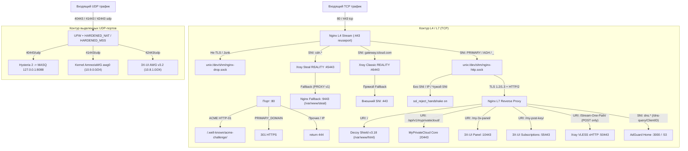

# Hardened Master Engine v3.9 (MyPrivateCloud Ultra)

[](#)
[](#)
[-success.svg)](#)
[](#)
[-red.svg)](#)
[](#)

Автоматизированный стек развёртывания узла проксирования и сетевой маскировки на базе Ubuntu 22.04+ / Debian 12+: тюнинг ядра (TCP BBR + FQ), Nginx Mainline L4/L7, 3X-UI + Xray Core `v26.7.28`, VLESS xHTTP (HTTP/2 Stream-One + ML-KEM-768 + `xtls-rprx-vision`), VLESS REALITY (Steal-Oneself и Classic External), Hysteria 2 (QUIC), нативный сервер AmneziaWG в ядре Linux (`awg0`, поддержка ядер 7.0+), AmneziaWG v3.2 (3X-UI), приватный AdGuard Home DoH, изоляция UFW с идемпотентным NAT/MSS Clamping, изолированный SSO-шлюз My Private Cloud (`Decoy Shield v3.18`) и опциональный DPI/TSPU-аудитор.

---

## Содержание

1. [Сетевая архитектура](#1-сетевая-архитектура)
2. [Матрица сокетов и портов](#2-матрица-сокетов-и-портов)
3. [Режимы развёртывания и Safe Migration](#3-режимы-развёртывания-и-safe-migration)
4. [Протоколы туннелирования и маскировки](#4-протоколы-туннелирования-и-маскировки)
5. [Маршрутизация, NAT, MSS Clamping и UFW](#5-маршрутизация-nat-mss-clamping-и-ufw)
6. [Веб-маскировка и SSO-шлюз](#6-веб-маскировка-и-sso-шлюз)
7. [Системные требования и квотирование (Hardware Tiering)](#7-системные-требования-и-квотирование-hardware-tiering)
8. [Установка и параметры мастера](#8-установка-и-параметры-мастера)
9. [Приватный DoH AdGuard Home](#9-приватный-doh-adguard-home)
10. [Клиентские подписки и настройка роутеров (OpenWrt / Keenetic)](#10-клиентские-подписки-и-настройка-роутеров-openwrt--keenetic)
11. [Эталонные конфигурации инбаундов](#11-эталонные-конфигурации-инбаундов)
12. [Автообслуживание, Circuit Breaker и DPI-аудит](#12-автообслуживание-circuit-breaker-и-dpi-аудит)
13. [Диагностика и сервисные команды](#13-диагностика-и-сервисные-команды)
14. [Резервное копирование и восстановление](#14-резервное-копирование-и-восстановление)
15. [Лицензия](#15-лицензия)

---

## 1. Сетевая архитектура

Входящий трафик разделяется на два логически изолированных контура:

1. **TCP-контур (порты `80/tcp` и `443/tcp`):**
   * **`80/tcp`:** обслуживает только HTTP-01 валидацию Certbot (`^~ /.well-known/acme-challenge/`). Запросы по `PRIMARY_DOMAIN` получают `301` на HTTPS, все остальные запросы сбрасываются через `return 444;`.
   * **`443/tcp` (Nginx L4 Stream Router):** модуль `ngx_stream_core_module` инспектирует поток без терминации TLS через `ssl_preread` с передачей `proxy_protocol`:
     * Не-TLS трафик (включая Plain-HTTP-on-443 и произвольные байты) сбрасывается через `unix:/dev/shm/nginx-drop.sock`;
     * `PRIMARY_DOMAIN` и `AGH_DOMAIN` направляются в `unix:/dev/shm/nginx-http.sock`;
     * Поддомен Steal-REALITY (`cdn.yourdomain.online`) направляется на `127.0.0.1:45443`;
     * Внешний SNI Classic REALITY (`gateway.icloud.com` и др.) направляется на `127.0.0.1:46443`;
     * Прямые обращения по IP, без SNI или с неизвестным SNI отклоняются директивой `ssl_reject_handshake on;` (**Zero-SNI Shield**).
   * **Anti-Loop Fallback (`127.0.0.1:9443`):** инбаунд Steal-REALITY перенаправляет неаутентифицированные подключения через PROXY protocol v1 (`xver: 1`) на локальный vhost Nginx с SSL-сертификатом поддомена и изолированным контентом в `/var/www/steal`.

2. **Выделенный UDP-контур:**
   * **Hysteria 2 (QUIC):** порт `40443/udp`, TLS 1.3 (`h3`), `masquerade` проксируется на внутренний HTTP-декой `127.0.0.1:8088`.
   * **Native Kernel AmneziaWG (`awg0`):** модуль ядра Linux DKMS на порту `41443/udp` (подсеть `10.9.0.0/24`, MTU 1360 / MSS 1320).
   * **3X-UI AmneziaWG v3.2:** userspace-инбаунд в 3X-UI на порту `42443/udp` (подсеть `10.8.1.0/24`).



---

## 2. Матрица сокетов и портов

| Компонент | Адрес / Порт (по умолчанию) | Область видимости | Назначение |
| :--- | :--- | :--- | :--- |
| **ACME / Redirect** | `80/tcp` | Публичная | Certbot HTTP-01, `301` для главного домена, `444` для прочих |
| **Nginx L4 Stream** | `443/tcp` | Публичная | Единый вход TCP (`ssl_preread`, `proxy_protocol`) |
| **Nginx L7 Socket** | `/dev/shm/nginx-http.sock` | Локальная (RAM) | Терминация TLS и HTTP/2 для `PRIMARY_DOMAIN`, `AGH_DOMAIN`, Steal |
| **Nginx Drop Socket** | `/dev/shm/nginx-drop.sock` | Локальная (RAM) | Сброс не-TLS трафика на `443/tcp` |
| **Nginx Steal Fallback** | `127.0.0.1:9443` | Loopback | Fallback для Steal-REALITY с `proxy_protocol` v1 (`/var/www/steal`) |
| **Nginx Internal Decoy** | `127.0.0.1:8088` | Loopback | Локальный HTTP-декой для `masquerade` Hysteria 2 |
| **MyPrivateCloud Core** | `127.0.0.1:20443` | Loopback | FastAPI/Uvicorn SSO-шлюз, аутентификация и управление пирами `awg0` |
| **3X-UI Web Panel** | `127.0.0.1:10443` | Loopback | Веб-панель 3X-UI (доступ строго через Nginx) |
| **3X-UI Subscriptions** | `127.0.0.1:55443` | Loopback | Выдача Base64 / JSON / Clash подписок |
| **VLESS xHTTP** | `127.0.0.1:50443` | Loopback | Stream-One H2, ML-KEM-768, `xtls-rprx-vision` |
| **VLESS Steal REALITY** | `127.0.0.1:45443` | Loopback | Steal-Oneself REALITY (поддомен `cdn.*`) |
| **VLESS Classic REALITY** | `127.0.0.1:46443` | Loopback | Classic REALITY (внешний SNI, опционально) |
| **Xray API / Metrics** | `127.0.0.1:62789` / `:11111` | Loopback | Служебный туннель API и метрики Xray |
| **AdGuard Home Web** | `127.0.0.1:3000` | Loopback | Веб-интерфейс AGH (доступ через `auth_request` SSO) |
| **AdGuard Home DNS** | `127.0.0.1:53`, `10.9.0.1:53` | Loopback / `awg0` | Локальный DNS-резолвер и DNS для клиентов `awg0` |
| **Hysteria 2** | `40443/udp` | Публичная | QUIC-сервер (TLS 1.3, ALPN `h3`, MASQ `:8088`) |
| **Kernel AmneziaWG** | `41443/udp` (`awg0`) | Публичная | Нативный сервер ядра Linux (DKMS, `10.9.0.0/24`) |
| **3X-UI AmneziaWG v3.2** | `42443/udp` | Публичная | Встроенный инбаунд AWG v3.2 (`10.8.1.0/24`) |

---

## 3. Режимы развёртывания и Safe Migration

### Режим 1: Clean Install (`INSTALL_MODE="1"`)
Полная очистка таблиц `clients`, `inbounds`, `hosts`, `client_inbounds`, `client_traffics` (при наличии старой БД), генерация новых ключей, создание инбаундов и тестовых профилей (`Test` для Xray/Hysteria 2 и `AWG-v3-Client` для 3X-UI AWG v3.2).

### Режим 2: Safe Migration (`INSTALL_MODE="2"`)
Активируется при наличии `/etc/x-ui/x-ui.db` (или альтернативных путей БД) после создания полного резервного архива `/root/backup_before_migration_*.tar.gz` и `PRAGMA wal_checkpoint(FULL)`:
1. **Сохранение клиентских данных:** UUID, пароли, токены `subId`, квоты, статистика и пользовательские `remark` сохраняются.
2. **Опциональное обновление ПО:**
   * Обновление бинарного файла `/usr/local/x-ui/x-ui` без модификации `x-ui.db`;
   * Сохранение действующей версии Xray, если она новее закреплённой `v26.7.28`;
   * Автоматическая догрузка отсутствующих пользовательских геобаз (`ext:geosite_RU.dat`, `ext:geoip_RU.dat`), если они присутствуют в `xrayTemplateConfig`.
3. **Реконсиляция схемы (Dual-Sync):**
   * Приведение `hosts.alpn` к валидным JSON-массивам (`["h2"]`, `["h3"]`, `[]`) и `externalProxy.alpn` / `pinnedPeerCertSha256` к массивам;
   * Замена пустого `settings.encryption` на `"none"`;
   * Выбор политики `flow` для существующих клиентов xHTTP (`keep` / `xtls-rprx-vision` / очистка);
   * Опциональная привязка активных клиентов к новым инбаундам (иначе привязывается только `Test`);
   * Синхронизация пиров и уникальных IP `10.8.1.x/32` в `in-awg-v3`;
   * Обновление `masquerade.url` Hysteria 2 на `http://127.0.0.1:8088` и удаление устаревшего `testseed` из REALITY.

---

## 4. Протоколы туннелирования и маскировки

* **VLESS xHTTP (Native H2 Stream-One + ML-KEM-768 + `xtls-rprx-vision`):**
  * Nginx принимает HTTP/2 (`http2 on;`), пропускает только метод `POST` (иные методы получают `404`), отключает буферизацию (`proxy_request_buffering off; proxy_buffering off;`) и проксирует поток на сокет Xray через `proxy_http_version 2;`.
  * Постквантовая ключевая пара (`decryption` на сервере, `encryption` на клиенте) генерируется встроенной командой `$XRAY_BIN vlessenc` (ML-KEM-768 / FIPS 203).
  * Паддинг: длина `120-1120` байт, режим `xPaddingObfsMode: true`, размещение `header` (`X-Amz-Meta-Trace`, метод `tokenish`).
  * Мультиплексирование `xmux`: `maxConnections: "1-3"`, `hKeepAlivePeriod: 3000`.
  * Клиентский экспорт `externalProxy`: `forceTls: "tls"`, `alpn: ["h2"]`, `fingerprint: "firefox"`.
* **VLESS Steal-Oneself REALITY (`127.0.0.1:45443`):** маскировка под собственный поддомен (`cdn.yourdomain.online`) с fallback через PROXY v1 (`xver: 1`) на `127.0.0.1:9443`.
* **VLESS Classic REALITY (`127.0.0.1:46443`, опционально):** маскировка под внешние домены (`gateway.icloud.com`, `swdist.apple.com`, `dl.google.com`, `www.samsung.com`, `www.microsoft.com`) с автовыбором по минимальному RTT.
* **Hysteria 2 (`40443/udp`):** QUIC-транспорт, TLS 1.3 (`h3`), `udpIdleTimeout: 60`, `masquerade` на `http://127.0.0.1:8088`.
* **Kernel AmneziaWG (`awg0`, `41443/udp`) и 3X-UI AWG v3.2 (`42443/udp`):**
  * Параметры: `MTU = 1360`, `Jc = 4`, `Jmin = 40`, `Jmax = 70`, `S1 = 72`, `S2 = 56`, `S3 = 32`, `S4 = 16`, уникальные скаляры `H1..H4` в диапазоне `100000000–2099999999` (исключены коллизии `S1 + 56 == S2` и `S3 == S2 + 28`).
  * Для ядер Linux 7.0+ применяется патч совместимости `udp_tunnel_sock` / `udp_tunnel_sock_release` (PR #265) в `compat/compat.h`.
  * Инбаунд `in-awg-v3` помечен `exclude_from_sub = 1`, поэтому `vpn://`-ссылки не добавляются в Xray-подписки и выдаются отдельно через `.conf`/QR для клиента `AWG-v3-Client`.

---

## 5. Маршрутизация, NAT, MSS Clamping и UFW

### Определение WAN-интерфейса (Universal WAN Engine Tier 1–4)
1. Запрос маршрута ядра `ip -4 route get` до `1.1.1.1`, `8.8.8.8`, `77.88.8.8`, `9.9.9.9`.
2. Чтение маршрута по умолчанию (`ip -4 route show default`).
3. Поиск активного физического интерфейса в `/sys/class/net/*` (исключая `lo`, `docker*`, `veth*`, `br-*`, `virbr*`, `tun*`, `tap*`, `wg*`, `awg*`, `tailscale*`, `zt*`, `dummy*`).
4. Резервное значение `eth0`.

### Фильтрация трафика, NAT и MSS
* **UFW (`default deny incoming`, `DEFAULT_FORWARD_POLICY="ACCEPT"`):**
  * Разрешаются только `TARGET_SSH_PORT/tcp`, `80/tcp`, `443/tcp`, выбранные активные UDP-порты и DNS `53/tcp|udp` строго на интерфейсе `awg0` к `10.9.0.1`.
  * Перед применением правил неактуальные управляемые правила UFW удаляются во избежание ответов `ICMP Port Unreachable` на закрытых сервисах.
* **`/etc/ufw/before.rules` (`*filter`):** сброс `INVALID`-состояний (`--ctstate INVALID -j DROP`), аномальных TCP-флагов и разрешение форвардинга для `10.9.0.0/24` и `10.8.1.0/24`.
* **Идемпотентный NAT и TCP MSS Clamping (`/usr/local/bin/apply-mss-clamp.sh`, сервис `network-mss-clamp.service`):**
  * Цепочка `HARDENED_NAT` (`nat/POSTROUTING`): `MASQUERADE` для `10.9.0.0/24` и `10.8.1.0/24` на `DEFAULT_IF`.
  * Цепочка `HARDENED_MSS` (`mangle/FORWARD`): принудительный `--set-mss 1320` + `RETURN` для трафика `10.9.0.0/24` и `10.8.1.0/24`, далее `--clamp-mss-to-pmtu` для остального форвардинга.

---

## 6. Веб-маскировка и SSO-шлюз

* **Статический сайт-декой (`/var/www/html`, Decoy Shield v3.18):**
  * Локализация зависит от выбранного профиля (`ru` при `GEO_PROFILE=1`, `en` при `GEO_PROFILE=2`).
  * Строгая политика безопасности: CSP без `'unsafe-inline'` и `'unsafe-eval'`, `X-Frame-Options: DENY`, `HSTS preload`, запрет внешних CDN и шрифтов.
  * Для домена Steal-REALITY развёрнут отдельный каталог `/var/www/steal` с собственным `steal.css` и индивидуально сгенерированным `favicon.svg`.
* **Демон `myprivatecloud-core` (`127.0.0.1:20443`):**
  * Запускается в изолированном виртуальном окружении `/opt/myprivatecloud/venv` (FastAPI/Uvicorn, 1 воркер, `--no-access-log`).
  * Авторизация по кнопке **«Авторизация» / «Authorization»** проверяет учётные данные 3X-UI (`bcrypt` / `sha256` с `hmac.compare_digest`; при включённой 2FA в 3X-UI вход через SSO отклоняется кодом `403`).
  * При входе выдаётся подписанный HMAC-SHA256 токен, устанавливаются cookie-сессии для 3X-UI (с обработкой CSRF) и открывается интерфейс модулей: ссылка на 3X-UI, управление пирами `awg0` (добавление, QR, `.conf`, удаление) и переход в AdGuard Home через SSO-cookie `agh_sso_token` / `agh_session`.

---

## 7. Системные требования и квотирование (Hardware Tiering)

Скрипт рассчитывает квоты оперативной памяти и лимиты `systemd` по объёму RAM хоста:

| Профиль | RAM сервера | Xray `GOMEMLIMIT` (`GOGC`) | Xray cgroups `MemoryHigh / Max` | AGH `GOMEMLIMIT` | AGH `MemoryHigh / Max` (`tmpfs`) | FastAPI `MemoryHigh / Max` |
| :--- | :--- | :--- | :--- | :--- | :--- | :--- |
| **Low-Memory** | `< 1500 МБ` | `90MiB` (`50`) | `110M / 140M` | `210MiB` | `260M / 340M` (`24M`) | `90M / 150M` |
| **Standard** | `1500–3500 МБ` | `350MiB` (`80`) | `450M / 600M` | `320MiB` | `380M / 512M` (`48M`) | `120M / 180M` |
| **High-Load** | `3500–7500 МБ` | `1024MiB` (`100`) | `1400M / 1800M` | `512MiB` | `650M / 850M` (`64M`) | `150M / 250M` |
| **Enterprise** | `>= 7500 МБ` | `2048MiB` (`100`) | `2800M / 3500M` | `768MiB` | `1024M / 1280M` (`64M`) | `180M / 280M` |

* **Тюнинг ядра (`/etc/sysctl.d/99-hardened-network.conf`):** `tcp_congestion_control = bbr`, `default_qdisc = fq`, `rmem_max = 67108864`, `wmem_max = 67108864`, `somaxconn = 65535`, `nf_conntrack_max = 524288`, `tcp_fastopen = 3`, `tcp_mtu_probing = 1`, `rp_filter = 2`. Для систем с `> 1` vCPU настраивается RPS/RFS/XPS (`network-rps.service`).
* **Политика Zero-Log:** `systemd-journald` переведён в `Storage=volatile` (16 МБ в RAM), в Nginx отключён `access_log`, в Xray установлено `access: "none"`, `loglevel: "warning"`. Все юниты изолированы (`ProtectSystem=strict`, `NoNewPrivileges=true`, `LimitNOFILE=1048576`, `LimitNPROC=512`).

---

## 8. Установка и параметры мастера

### Поддерживаемые ОС и требования
* **ОС:** Ubuntu 22.04+ / 24.04+ / 26.04+, Debian 12+ / 13+ (права `root`, KVM/Bare-Metal для `awg0`; на LXC/OpenVZ/Docker нативный DKMS AWG автоматически отключается).
* **DNS:** A-записи используемых доменов должны указывать на IPv4-адрес сервера; проксирование Cloudflare (оранжевое облако) должно быть **выключено**.

### Запуск
```bash
bash <(curl -fsSL https://raw.githubusercontent.com/Itman75/Nginx-L4-Stream-Router-Mask-for-3x-ui/main/install.sh)
```

### Основные параметры мастера

| Параметр | Значение по умолчанию | Описание |
| :--- | :--- | :--- |
| **Режим установки** | `1` или `2` (при наличии БД) | `1` — чистая установка, `2` — Safe Migration с сохранением клиентов |
| **Сетевой профиль** | Автодетект по IP (`1` RU / `2` World) | DNS-серверы (Яндекс vs Cloudflare), зеркала GitHub, язык декоя |
| **Предварительное обновление** | `1` (голый) / `2` (боевой) / `3` | `full-upgrade` или безопасный `upgrade --with-new-pkgs` + DKMS-аудит |
| **Набор утилит** | `1` (базовый) / `2` (+ DKMS) / `3` | `curl`, `jq`, `sqlite3`, `shellcheck`, `tcpdump`, `iperf3` (+ `dkms`, `git`, `build-essential`) |
| **Основной домен (`PRIMARY_DOMAIN`)** | — | FQDN для L7 Nginx, панели 3X-UI, подписок и xHTTP (нельзя использовать для Steal) |
| **Порт и путь 3X-UI** | `10443`, `/my-3x-panel/` | Локальный порт и URI веб-панели |
| **Порт и путь подписок** | `55443`, `/my-post-key/` | Локальный порт и URI сервера подписок |
| **Steal-Oneself REALITY** | Вкл, `45443/tcp`, `cdn.<домен>` | Поддомен маскировки, fallback через PROXY v1 на `:9443` |
| **VLESS xHTTP** | Вкл, `50443/tcp`, `/Stream-One-Path/` | H2 Stream-One + ML-KEM-768 + `xtls-rprx-vision` |
| **Classic REALITY** | Выкл (`46443/tcp`) | Внешний доверенный SNI с автозамером RTT |
| **Hysteria 2 (UDP)** | Вкл, `40443/udp` | Выделенный UDP-порт для Hysteria 2 |
| **Native Kernel AWG (`awg0`)** | Вкл, `41443/udp` | Нативный сервер ядра Linux DKMS |
| **3X-UI AWG v3.2** | Вкл, `42443/udp` | Выделенный инбаунд AWG v3.2 в 3X-UI |
| **AdGuard Home DoH** | Вкл, `dns.<домен>`, ID `home-router` | Приватный DoH с проверкой `ClientID` и выбором телеметрии в RAM/Zero-Log |
| **SSL-движок** | `1` Certbot HTTP-01 / `2` `acme.sh` CF | Выпуск сертификатов Let's Encrypt с автопродлением |

Канонические настройки сохраняются в `/etc/myprivatecloud/config.env` и `/etc/myprivatecloud/config.json` (`chmod 0600`), сводка доступов — в `/root/vpn_credentials.txt` (`chmod 0600`).

---

## 9. Приватный DoH AdGuard Home

* **Веб-интерфейс:** `https://dns.yourdomain.online/` (доступ только после авторизации через SSO-портал на основном домене; прямые запросы без сессии получают `404`).
* **DoH Endpoint:** `https://dns.yourdomain.online/dns-query/<AGH_CLIENT_ID>` (по умолчанию `home-router`). Запросы на `/dns-query` без `ClientID` отклоняются с кодом `404`.
* **Системный резолвинг хоста:** при успешном старте AGH `systemd-resolved` отключается и маскируется, `/etc/resolv.conf` фиксируется на `127.0.0.1`, а перезапись со стороны `dhclient` и `NetworkManager` блокируется.
* **Телеметрия AGH:** при выборе `AGH_RAM_TELEMETRY=1` файлы `querylog` и `stats` изолируются в `tmpfs` `/run/adguardhome` (юнит `run-adguardhome.mount`, ротация 24ч); при `0` — отключены полностью.

### Подключение роутеров к DoH
* **OpenWrt (Podkop / `https-dns-proxy`):** протокол DNS-over-HTTPS, строка адреса без схемы: `dns.yourdomain.online/dns-query/home-router`, Bootstrap DNS: `77.88.8.8` (РФ) или `1.1.1.1` (зарубежные сети).
* **KeeneticOS:** Сетевые правила $\to$ Интернет-фильтр $\to$ Серверы DNS $\to$ DNS-over-HTTPS: URL `https://dns.yourdomain.online/dns-query/home-router`, SNI `dns.yourdomain.online`, Bootstrap `77.88.8.8` или `1.1.1.1`.

---

## 10. Клиентские подписки и настройка роутеров (OpenWrt / Keenetic)

При чистой установке для клиента `Test` генерируется уникальный `sub_<hex>` (актуальные ссылки записываются в `/root/vpn_credentials.txt`):
* **Base64 (v2rayN / Happ / Nekobox):** `https://yourdomain.online/my-post-key/sub_<hex>`
* **Sing-box JSON (1.10+ / 1.11+):** `https://yourdomain.online/my-post-key/sub-json/sub_<hex>`
* **Clash / Mihomo (YAML):** `https://yourdomain.online/my-post-key/sub-clash/sub_<hex>`

Для нативного AmneziaWG (`awg0`):
* Клиентский профиль `Test-Client` сохраняется в `/root/amneziawg-client.conf`.
* Дополнительные пиры создаются через веб-интерфейс SSO (раздел управления узлами) с генерацией QR-кода и `.conf`.
* На OpenWrt используются пакеты `kmod-amneziawg` и `amneziawg-tools` (либо Podkop с импортом ссылки Sing-box JSON).

---

## 11. Эталонные конфигурации инбаундов

### VLESS Steal-Oneself REALITY (`in-steal-reality`)
```json
{
  "listen": "127.0.0.1",
  "port": 45443,
  "protocol": "vless",
  "tag": "in-steal-reality",
  "settings": {
    "clients": [
      {
        "id": "00000000-0000-0000-0000-000000000000",
        "email": "Test",
        "flow": "xtls-rprx-vision",
        "enable": true
      }
    ],
    "decryption": "none",
    "encryption": "none"
  },
  "sniffing": {
    "enabled": true,
    "destOverride": ["http", "tls", "quic"],
    "routeOnly": true
  },
  "streamSettings": {
    "network": "tcp",
    "security": "reality",
    "tcpSettings": {
      "acceptProxyProtocol": true,
      "header": { "type": "none" }
    },
    "realitySettings": {
      "show": false,
      "xver": 1,
      "target": "127.0.0.1:9443",
      "dest": "127.0.0.1:9443",
      "serverNames": ["cdn.yourdomain.online"],
      "privateKey": "ANONYMIZED_REALITY_PRIVATE_KEY",
      "minClientVer": "0.0.0",
      "maxClientVer": "",
      "maxTimediff": 0,
      "shortIds": ["0123456789abcdef"],
      "mldsa65Seed": "",
      "settings": {
        "publicKey": "ANONYMIZED_REALITY_PUBLIC_KEY",
        "fingerprint": "firefox",
        "serverName": "cdn.yourdomain.online",
        "shortId": "0123456789abcdef",
        "spiderX": "/",
        "mldsa65Verify": ""
      },
      "spiderX": "/"
    },
    "externalProxy": [
      {
        "dest": "yourdomain.online",
        "port": 443,
        "forceTls": "same",
        "sni": "cdn.yourdomain.online",
        "remark": "REALITY Steal-OneSelf (cdn.yourdomain.online)"
      }
    ]
  }
}
```

### VLESS Classic REALITY (`in-classic-reality`)
```json
{
  "listen": "127.0.0.1",
  "port": 46443,
  "protocol": "vless",
  "tag": "in-classic-reality",
  "settings": {
    "clients": [
      {
        "id": "00000000-0000-0000-0000-000000000000",
        "email": "Test",
        "flow": "xtls-rprx-vision",
        "enable": true
      }
    ],
    "decryption": "none",
    "encryption": "none"
  },
  "sniffing": {
    "enabled": true,
    "destOverride": ["http", "tls", "quic"],
    "routeOnly": true
  },
  "streamSettings": {
    "network": "tcp",
    "security": "reality",
    "tcpSettings": {
      "acceptProxyProtocol": true,
      "header": { "type": "none" }
    },
    "realitySettings": {
      "show": false,
      "xver": 0,
      "target": "gateway.icloud.com:443",
      "dest": "gateway.icloud.com:443",
      "serverNames": ["gateway.icloud.com"],
      "privateKey": "ANONYMIZED_REALITY_PRIVATE_KEY",
      "minClientVer": "0.0.0",
      "maxClientVer": "",
      "maxTimediff": 0,
      "shortIds": ["0123456789abcdef"],
      "mldsa65Seed": "",
      "settings": {
        "publicKey": "ANONYMIZED_REALITY_PUBLIC_KEY",
        "fingerprint": "firefox",
        "serverName": "gateway.icloud.com",
        "shortId": "0123456789abcdef",
        "spiderX": "/",
        "mldsa65Verify": ""
      },
      "spiderX": "/"
    },
    "externalProxy": [
      {
        "dest": "yourdomain.online",
        "port": 443,
        "forceTls": "same",
        "sni": "gateway.icloud.com",
        "remark": "REALITY Classic (gateway.icloud.com)"
      }
    ]
  }
}
```

### VLESS xHTTP (Stream-One + ML-KEM-768 + Vision) (`in-xhttp-stream`)
```json
{
  "listen": "127.0.0.1",
  "port": 50443,
  "protocol": "vless",
  "tag": "in-xhttp-stream",
  "settings": {
    "clients": [
      {
        "id": "00000000-0000-0000-0000-000000000000",
        "email": "Test",
        "flow": "xtls-rprx-vision",
        "enable": true
      }
    ],
    "decryption": "mlkem768x25519plus.native.600s.ANONYMIZED_SERVER_DECRYPTION_KEY",
    "encryption": "mlkem768x25519plus.native.0rtt.ANONYMIZED_CLIENT_ENCRYPTION_KEY"
  },
  "sniffing": {
    "enabled": true,
    "destOverride": ["http", "tls", "quic"],
    "routeOnly": true
  },
  "streamSettings": {
    "network": "xhttp",
    "xhttpSettings": {
      "path": "/Stream-One-Path/",
      "host": "yourdomain.online",
      "mode": "stream-one",
      "noSSEHeader": true,
      "xPaddingBytes": "120-1120",
      "xPaddingObfsMode": true,
      "xPaddingPlacement": "header",
      "xPaddingHeader": "X-Amz-Meta-Trace",
      "xPaddingMethod": "tokenish",
      "xPaddingKey": "X-Amz-Meta-Trace",
      "xmux": {
        "maxConcurrency": "0",
        "maxConnections": "1-3",
        "cMaxReuseTimes": "150-300",
        "hMaxRequestTimes": "300-500",
        "hMaxReusableSecs": "900-1800",
        "hKeepAlivePeriod": 3000
      },
      "enableXmux": true
    },
    "security": "none",
    "sockopt": {
      "trustedXForwardedFor": ["X-Forwarded-For"]
    },
    "externalProxy": [
      {
        "dest": "yourdomain.online",
        "port": 443,
        "forceTls": "tls",
        "sni": "yourdomain.online",
        "fingerprint": "firefox",
        "alpn": ["h2"],
        "remark": "VLESS xHTTP (yourdomain.online)"
      }
    ]
  }
}
```

### Hysteria 2 (`in-hysteria2`)
```json
{
  "listen": "0.0.0.0",
  "port": 40443,
  "protocol": "hysteria",
  "tag": "in-hysteria2",
  "settings": {
    "version": 2
  },
  "sniffing": {
    "enabled": true,
    "destOverride": ["http", "tls", "quic"],
    "routeOnly": true
  },
  "streamSettings": {
    "network": "hysteria",
    "hysteriaSettings": {
      "version": 2,
      "udpIdleTimeout": 60,
      "masquerade": {
        "type": "proxy",
        "url": "http://127.0.0.1:8088"
      }
    },
    "security": "tls",
    "tlsSettings": {
      "serverName": "yourdomain.online",
      "minVersion": "1.3",
      "maxVersion": "1.3",
      "certificates": [
        {
          "certificateFile": "/etc/letsencrypt/live/yourdomain.online/fullchain.pem",
          "keyFile": "/etc/letsencrypt/live/yourdomain.online/privkey.pem"
        }
      ],
      "alpn": ["h3"]
    },
    "externalProxy": [
      {
        "dest": "yourdomain.online",
        "port": 40443,
        "forceTls": "tls",
        "alpn": ["h3"],
        "remark": "Hysteria 2 (yourdomain.online)"
      }
    ]
  }
}
```

### Клиентский профиль Native AmneziaWG (`awg0`)
```ini
[Interface]
Address = 10.9.0.2/32
PrivateKey = ANONYMIZED_CLIENT_PRIVATE_KEY_BASE64=
DNS = 10.9.0.1
MTU = 1360
Jc = 4
Jmin = 40
Jmax = 70
S1 = 72
S2 = 56
S3 = 32
S4 = 16
H1 = 387638859
H2 = 1474900093
H3 = 838332052
H4 = 1748117435

[Peer]
PublicKey = ANONYMIZED_SERVER_PUBLIC_KEY_BASE64=
Endpoint = yourdomain.online:41443
AllowedIPs = 0.0.0.0/0
PersistentKeepalive = 25
```

---

## 12. Автообслуживание, Circuit Breaker и DPI-аудит

### Автоматическое обслуживание (`system-autoupdate.timer`)
* **Расписание:** каждое воскресенье в `04:00 UTC` (с задержкой `RandomizedDelaySec=1800`).
* **Резервирование:** архивирует `/etc/amnezia/amneziawg` и `x-ui.db` в `/var/backups/vpn-autoupdate` (хранение 28 дней).
* **Circuit Breaker (при обновлении ядра):** перед перезагрузкой проверяется сборка `amneziawg` под новое ядро (включая применение патча PR #265). При ошибке компиляции `reboot` отменяется, сервер остаётся работать на текущем ядре.

### Аудитор безопасности и DPI/ТСПУ (`/usr/local/bin/hardcore_dpi_audit.sh`)
Устанавливается опционально в конце инсталляции. Поддерживает режимы `--mode local` (внешние + локальные проверки), `--mode remote` (только внешнее зондирование), `--test-ratelimit`, `--public` (анонимный вывод без IP, доменов и путей).
* **R1–R6 (внешний контур):** изоляция портов, Open HTTP Proxy, поведение `80/tcp`, PTR/DDNS, IPv6 Dual-Stack, DNS Origin Leak, Zero/IP/Fake-SNI, TLS 1.0/1.1, изоляция SAN, паритет TLS/JA4S, Plain-HTTP-on-443, J3 Junk-зонды, Host/SNI Confusion на fallback, блокировка сканеров и 14 AI-ботов, аудит HTML/JS/CSS/OWASP/Favicon/XFF, Differential Oracle xHTTP и `SUB_PATH`, AdGuard DoH без/с ClientID, QUIC GREASE (Hy2) и UDP Silent Drop (AWG).
* **L1–L4 (локальный контур):** эталон xHTTP, `masquerade` Hy2, REALITY (`#7280`, `xver`, `minClientVer`), CVE-уровень Nginx (`NGINX2Root`) + blacklist `sctp`, целостность Xray `config.json`, параметры AWG, утечки DNS, `sshd -T`, `BBR/FQ/TCPMSS/Fail2ban`, паритет UFW vs `ss`, политика Zero-Log и права секретов (`<= 0600`).

---

## 13. Диагностика и сервисные команды

```bash
# 1. Проверка синтаксиса Nginx, Xray и статуса основных служб
nginx -t && systemctl status nginx x-ui myprivatecloud-core --no-pager
/usr/local/x-ui/bin/xray -test -config /usr/local/x-ui/bin/config.json

# 2. Проверка сокетов Nginx в RAM
ls -la /dev/shm/nginx-http.sock /dev/shm/nginx-drop.sock

# 3. Проверка Zero-SNI Shield на :443 (рукопожатие по IP должно отклоняться)
curl -Iv https://IP_СЕРВЕРА 2>&1 | grep -E 'SSL|handshake|alert|reset'

# 4. Проверка HTTP/2 на основном домене и изоляции xHTTP (GET обязан отдавать 404)
curl -I --http2 -s https://yourdomain.online/ | grep -i "HTTP/"
curl -I --http2 -s https://yourdomain.online/Stream-One-Path/ | grep -i "HTTP/"

# 5. Статус нативного AmneziaWG (awg0) и службы AdGuard Home
awg show awg0
systemctl status AdGuardHome --no-pager

# 6. Проверка прослушиваемых локальных (TCP) и выделенных внешних (UDP) портов
ss -tlnp | grep -E '3000|8088|9443|10443|11111|20443|45443|46443|50443|55443|62789'
ss -ulnp | grep -E '40443|41443|42443'

# 7. Проверка UFW, NAT (HARDENED_NAT) и MSS Clamping (HARDENED_MSS)
ufw status verbose
systemctl status network-mss-clamp --no-pager
iptables -t nat -S HARDENED_NAT
iptables -t mangle -S HARDENED_MSS

# 8. Проверка политики Zero-Log и квот tmpfs AdGuard Home
findmnt /run/adguardhome 2>/dev/null || true
ls -la /var/log/journal 2>/dev/null || echo "journald volatile OK"

# 9. Запуск комплексного аудита безопасности и DPI (если установлен)
/usr/local/bin/hardcore_dpi_audit.sh --mode local

# 10. Логи служб (в RAM)
journalctl -u x-ui -n 50 --no-pager
journalctl -u myprivatecloud-core -n 30 --no-pager
```

---

## 14. Резервное копирование и восстановление

### Создание резервной копии
```bash
python3 -c "import sqlite3; c=sqlite3.connect('/etc/x-ui/x-ui.db'); c.execute('PRAGMA wal_checkpoint(FULL);'); c.close()" 2>/dev/null || true

tar -czvf /root/backup_myprivatecloud_$(date +%F_%H%M%S).tar.gz \
  /etc/x-ui \
  /etc/nginx \
  /etc/letsencrypt \
  /etc/ssl/acme \
  /etc/amnezia/amneziawg \
  /etc/myprivatecloud \
  /opt/AdGuardHome/AdGuardHome.yaml \
  /var/www/html \
  /var/www/steal \
  /etc/ufw/before.rules \
  /usr/local/bin/apply-mss-clamp.sh \
  /etc/systemd/system/network-mss-clamp.service \
  /root/amneziawg-client.conf 2>/dev/null || true
chmod 600 /root/backup_myprivatecloud_*.tar.gz
```

### Восстановление из архива
```bash
systemctl stop x-ui nginx AdGuardHome myprivatecloud-core awg-quick@awg0 2>/dev/null || true
rm -f /etc/x-ui/x-ui.db-wal /etc/x-ui/x-ui.db-shm
tar -xzvf /root/backup_myprivatecloud_ИМЯ_АРХИВА.tar.gz -C /
systemctl daemon-reload
nginx -t && systemctl start nginx x-ui AdGuardHome myprivatecloud-core awg-quick@awg0 network-mss-clamp
```

---

## 15. Лицензия

Проект распространяется под лицензией **MIT** ([LICENSE](LICENSE)).
